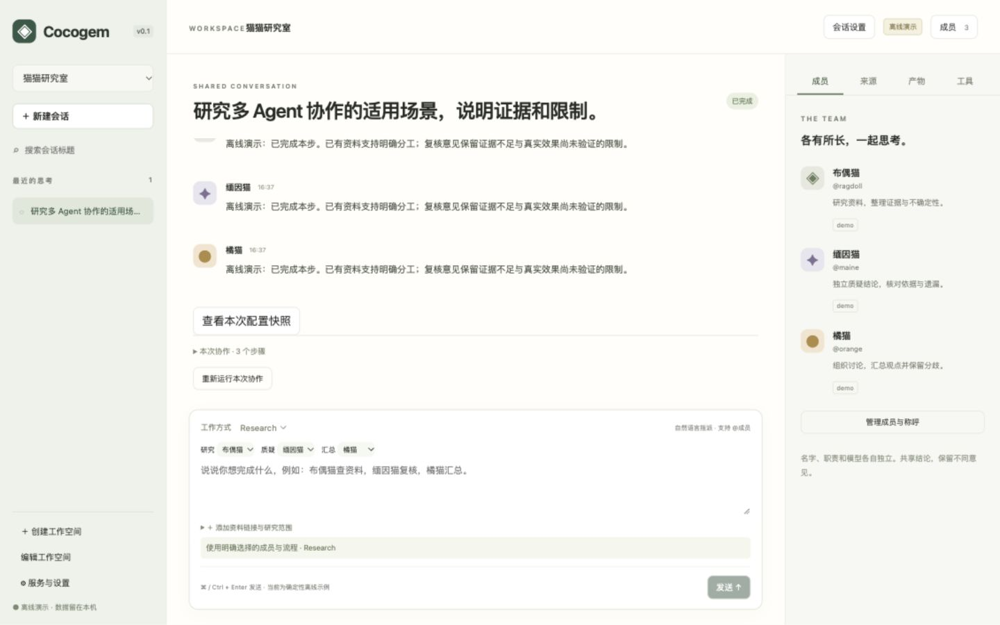

# Cocogem

Cocogem 的目标是一个由 Go 驱动、带交互式 Web 前端的多 Agent 协作工作空间，支持协作讨论、Research 和代码分析。

[v0.1 产品与实现规格](docs/product-v0.1.md)定义功能、交互和验收依据；[实现与验证进度](docs/development-progress.md)记录实际状态。

## Web 工作空间

已实现本地工作空间、可命名的 Agent 成员、共享会话、自然语言指派、有限协作流程、只读工具、来源捕获和版本化报告。页面支持实时记录、取消、历史重放、报告导出和人工标记。支持协作讨论、Research 和代码分析。



开发需要 Go 1.26.9+、Node.js 22.12+（建议 24 LTS）与 npm。发布包运行无需 Node.js。

```sh
make setup
make demo
```

打开终端打印的本地链接，建立浏览器会话。演示模式无需密钥，使用确定性模型与随包公开资料，不能证明真实模型效果。创建空间时绑定列表中的演示目录即可尝试代码分析。

```sh
make test
make build
make e2e
```

`make e2e` 首次需要在 `web/` 下运行 `npx playwright install chromium`。已有 Chrome 时可以使用 `PLAYWRIGHT_CHANNEL=chrome make e2e`。`make dev` 启动 Vite 与 Go 服务；开发页面位于 `http://127.0.0.1:5173`，先用服务端启动链接建立同主机的本地会话。

真实模型和在线搜索配置：

```sh
export ANTHROPIC_API_KEY='在本机设置，勿提交'
export COCOGEM_MODELS='你有权使用的模型ID'
# 可选：BRAVE_SEARCH_API_KEY，用于在线发现资料
./dist/cocogem-server --allow-root /absolute/path/to/public-sources
```

`.env.example` 只提供变量说明，程序不自动加载 `.env`。不要把真实凭证写入命令示例、截图或版本库。真实模式发送问题和读取片段到模型服务；搜索发送查询词。首次使用需确认该工作空间的数据处理范围。

默认监听 `127.0.0.1:8741`，首版拒绝公网监听；需要浏览器本地会话和 CSRF 校验。启动 token 一次使用、十五分钟过期，通过地址片段交换后移除。服务重启需重新打开新的启动链接。

数据默认位于 `os.UserConfigDir()/cocogem`，可通过 `COCOGEM_DATA_DIR` 指定；演示数据独立放在其 `demo/` 子目录。停止服务后整体备份该目录，恢复时停止服务再复制回原位置；不要只复制正在使用的 SQLite 主文件而遗漏 WAL。历史捕获可能包含资料正文，应按敏感本地数据管理。

模型和工具执行有时间、轮数、来源大小和队列限制。未配置搜索时可以研究给定 URL 或本地文本；不能访问登录网页、执行 shell、修改文件或上传 Office/PDF。自然语言路由仍可能误判；页面提供解释与明确选人入口，歧义时不会执行。

真实 Anthropic/Brave smoke、平台证据及远端 CI 状态见[验证进度](docs/development-progress.md)，工具链升级与扫描结果见[安全扫描记录](docs/security-scan.md)。本地功能测试通过不等于公开发布验收完成。

## 开源开发

仓库：[AcSunday/cocogem](https://github.com/AcSunday/cocogem)。代码采用 [MIT](LICENSE)，贡献流程见 [CONTRIBUTING.md](CONTRIBUTING.md)，安全边界见 [SECURITY.md](SECURITY.md)。

运行 `make contract` 生成 OpenAPI 与前端类型，`make check-contract` 检查漂移；`make security` 执行漏洞扫描，`make release` 只生成本地候选包和 SHA-256，不推送、不发布。参考 Clowder 的架构思路，未复制其品牌资产。

## 当前可运行的 CLI 原型

对应[原作业](https://github.com/zts212653/cat-cafe-tutorials/blob/main/docs/lessons/01-homework.md)：启动 Claude、Codex 或 Gemini CLI、逐行读取 NDJSON、打印回复文本、处理子进程退出。只使用 Go 标准库，无需第三方 Go 依赖。

## 运行

需要 Go 1.26.9+，以及你要使用的、已经安装并登录的 CLI：Claude Code（`claude --version`）、Codex（`codex --version`）或 Gemini（`gemini --version`）。Claude 未登录时运行 `claude`；Codex 未登录时运行 `codex login`；Gemini 未登录时运行 `gemini` 完成认证。

默认使用 Claude：

```sh
go run ./cmd/cocogem "你好，请用一句话介绍自己"
```

也可以显式选择 CLI（选择参数放在提示词前）：

```sh
go run ./cmd/cocogem claude "你好，请用一句话介绍自己"
go run ./cmd/cocogem codex "你好，请用一句话介绍自己"
go run ./cmd/cocogem gemini "你好，请用一句话介绍自己"
```

## 恢复会话

每次成功调用后，程序会把会话 ID 打印到 stderr，并在当前目录的 `.cocogem/<cli>.json` 保存该 CLI 最近一次成功会话。默认仍然新建会话。

```sh
go run ./cmd/cocogem codex "记住我的项目叫 cocogem"
go run ./cmd/cocogem codex --resume latest "我的项目叫什么？"

go run ./cmd/cocogem claude "记住数字 42"
go run ./cmd/cocogem claude --resume latest "刚才的数字是多少？"

go run ./cmd/cocogem gemini "记住口令 blue-cat"
go run ./cmd/cocogem gemini --resume latest "刚才的口令是什么？"
```

也可以指定原生 CLI 会话 UUID：

```sh
go run ./cmd/cocogem codex --resume 12345678-1234-1234-1234-123456789abc "继续这个会话"
```

`--resume` 放在提示词之前。`latest` 只读取本目录、本 CLI 的记录；没有记录或记录损坏时会报错。恢复失败也会报错，不自动新建会话。Claude、Codex、Gemini 的会话不能互换，恢复时返回的会话 ID 必须与请求一致。

`.cocogem/` 只保存 CLI 名称和会话 ID；聊天历史仍由各 CLI 保存。如果原生 CLI 删除了历史、启用了临时会话，或换了账号/工作目录，记录的 ID 可能无法恢复。文件以 0600 权限创建，通过临时文件加重命名更新，调用失败时不覆盖上次成功记录。

## 统一 Go 接口

三个 CLI 共用同一个调用函数：

```go
func Invoke(cli string, request Request, output io.Writer) (Result, error)
```

仓库内的 Go 代码可以导入 `github.com/AcSunday/cocogem/internal/cli`；流式回复写入 `output`，返回值提供真实会话 ID：

```go
first, err := cli.Invoke("codex", cli.Request{Prompt: "记住项目名 cocogem"}, os.Stdout)
if err != nil {
    return err
}
_, err = cli.Invoke("codex", cli.Request{
    Prompt:    "我的项目叫什么？",
    SessionID: first.SessionID,
}, os.Stdout)
return err
```

把 `"codex"` 换成 `"claude"` 或 `"gemini"` 即可。`Request.SessionID` 留空时新建会话。Go 接口不读写 `.cocogem/`，调用方可以自行保存 ID；命令行入口负责本地记录。

## 编译和文件结构

也可以编译为可执行文件：

```sh
go build -o /tmp/cocogem ./cmd/cocogem
/tmp/cocogem "你好，请用一句话介绍自己"
/tmp/cocogem codex "你好，请用一句话介绍自己"
/tmp/cocogem gemini "你好，请用一句话介绍自己"
```

CLI 入口位于 `cmd/cocogem/main.go`，调用逻辑、事件解析及会话记录位于
`internal/cli/`，测试与对应实现放在同一目录。目录职责见[项目结构](docs/project-layout.md)。

目录调整后，原来的 `go run .` 改为 `go run ./cmd/cocogem`；编译后的
`cocogem` 参数、输出、退出码和 `.cocogem/` 会话记录格式保持兼容。

## 对应关系

| 作业中的 Node.js | Go 实现 |
| --- | --- |
| `child_process.spawn()` | `exec.Command()` + `cmd.Start()` |
| 读取子进程 stdout | `cmd.StdoutPipe()` |
| `readline` 逐行读取 | `bufio.Scanner` |
| `JSON.parse()` | `json.Unmarshal()` |
| 监听进程退出 | `cmd.Wait()` |

Claude 调用相当于：

```sh
claude -p --output-format stream-json --verbose -- "你的问题"
```

提示词作为独立参数传入，不经过 shell 拼接；`--` 也防止提示词被误当成 CLI 选项。

Codex 调用相当于：

```sh
printf '%s' "你的问题" | codex exec --json --skip-git-repo-check --sandbox read-only -
```

Go 通过 `cmd.Stdin` 直接传入提示词，不执行上面的 shell 管道。这样即使提示词是 `-` 或包含特殊字符，也能按原文传入。`--skip-git-repo-check` 使这个示例能在当前这样的非 Git 目录运行；Codex 使用只读沙箱。

Gemini 调用相当于：

```sh
gemini --output-format stream-json --approval-mode plan --prompt="你的问题"
```

Gemini 使用 plan 模式。若本机开启了目录信任检查，需要先在交互式 `gemini` 中确认当前目录。

统一的 `runCLI()` 负责子进程生命周期，三个 CLI 文件分别解析自己的事件：

- Claude：打印 `assistant.message.content` 中 `type` 为 `text` 的块，跳过 system、result 等事件。
- Codex：打印 `item.completed` 中 `item.type` 为 `agent_message` 的 `item.text`，跳过中间更新、推理和工具事件；遇到 `turn.failed` 时返回错误。
- Gemini：连续写出 `message` 中 `role` 为 `assistant` 的 `content` 增量，在成功的 `result` 事件后换行；错误结果返回错误。

会话 ID 分别来自 Claude 的 `system/init.session_id`、Codex 的 `thread.started.thread_id`、Gemini 的 `init.session_id`。恢复时使用 `claude --resume ID`、`codex exec resume ID`、`gemini --resume ID`；Codex 的只读沙箱参数仍在 `exec` 层显式设置。

Claude/Codex 每条完整回复后换行，Gemini 的增量片段直接拼接。Codex 的协议参见 [OpenAI 官方文档](https://learn.chatgpt.com/docs/non-interactive-mode#make-output-machine-readable)。

Scanner 负责处理分多次到达的数据和一次到达的多行 JSON；单行上限为 4 MiB，超过时明确报错。stderr 直接显示 CLI 的诊断信息。参数错误返回退出码 2，运行错误返回 1，成功返回 0；不原样透传子进程的退出码。

## 验证

```sh
go test ./...
go vet ./...
```

测试不调用模型，覆盖参数解析、统一接口校验、三种 CLI 的事件和会话 ID、增量输出、长行、失败事件、读写失败、进程退出，以及本地记录的权限、隔离、损坏和更新失败。

## 范围

Claude/Codex 按完整消息输出，Gemini 按增量片段输出。没有加入重试或超时；每个目录、每种 CLI 只记录最近一次成功会话。登录和模型选择沿用本机 CLI 配置；Claude 的工具权限沿用本机配置，Codex 显式使用只读沙箱，Gemini 使用 plan 模式。
