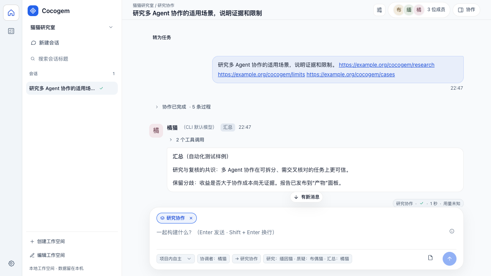
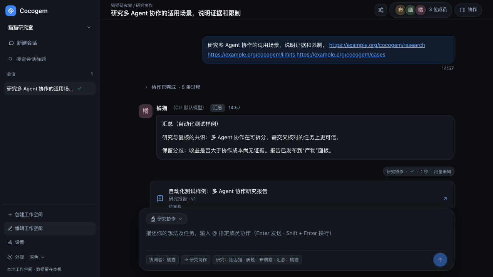
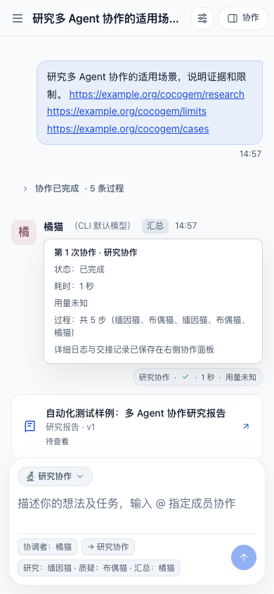

<div align="center">

# Cocogem

**Give your task a team.**

Let Claude Code, Codex, Gemini, and Pi discuss, research, develop, and review in one workspace.

[](https://github.com/AcSunday/cocogem/actions/workflows/ci.yml)
[](https://go.dev/)
[](https://nodejs.org/)
[](LICENSE)
[](CONTRIBUTING.md)

**English** | [简体中文](README.zh-CN.md)

[Quick Start](#quick-start) · [Features](#what-it-does) · [Product Guide](docs/product.md) · [Contributing](CONTRIBUTING.md)

</div>

## Why Cocogem?

You already have a few AI CLIs you rely on, but you still move context between terminals, relay opinions, and ask the next agent to review the work. The more complex the task, the more time goes into coordination.

Cocogem brings them into one local workspace. Describe your goal; members divide the work, hand off tasks, and check each other's results. Conversations, sources, and deliverables stay available for review. Each member can use a different CLI and model, reusing your existing API keys, endpoints, providers, and model settings without an extra Cocogem model key or a new login.

## See It in Action



<details>
<summary>Dark mode and mobile</summary>





</details>

These screenshots use synthetic data to demonstrate the interface. They do not establish the quality of real model research or deliverables.

## Quick Start

You need Go 1.26.10+ within the 1.26 series, Node.js 22.12+ (24 LTS recommended), npm, and at least one working local agent CLI.

```sh
git clone https://github.com/AcSunday/cocogem.git
cd cocogem
make setup
make dev
```

Open [http://127.0.0.1:5173](http://127.0.0.1:5173):

1. Set a local access password of 12–128 characters on first use.
2. In Settings → Members (设置 → 成员), create a member and choose a CLI. Leave the model empty or choose `default` to use the CLI's configuration.
3. Create a workspace and add members. Bind a local directory if you want to analyze or modify a project.
4. Start a conversation and describe your task. Use `@` to address members or explain the collaboration in natural language.

Enter sends; Shift+Enter inserts a newline. Member completion and IME confirmation are supported. The local access password unlocks the web interface independently of the CLI's model credentials.

### Run a Build

```sh
make build
./dist/cocogem-server
```

Open [http://127.0.0.1:8741](http://127.0.0.1:8741). Keep `dist/cocogem-server` alongside `dist/web/`. Node.js is not required at runtime; the local agent CLIs are still required.

Use `COCOGEM_DATA_DIR` to choose the data directory and `--allow-root /absolute/project` to restrict workspace directories. Proxy, search, timeout, and backup settings are covered in the [product guide (Chinese)](docs/product.md#配置与启动).

## What It Does

| Capability | How it works |
| --- | --- |
| Free collaboration | Use `@` or natural language; the coordinator answers, hands off tasks, or selects a built-in workflow as needed |
| Team discussion | Members form independent views, challenge each other, and check the synthesis while preserving disagreements |
| Research | Search and read sources, then challenge, respond, and recheck before delivering a research report |
| Engineering analysis and development | Analysis stays read-only; explicitly authorized development combines changes, tests, independent review, and fixes |
| Reusable members | Share global profiles across workspaces, with separate roles, models, execution options, avatars, and tool grants |
| Sources and deliverables | Inspect captured sources, exact report versions, and human feedback; export Markdown or JSON |
| Long tasks and recovery | Stream output, stop tasks, inspect failures, and resume from checkpoints while retaining completed steps and history |
| Everyday workspace tools | Search, rename, and restore conversations; choose light, dark, warm, or system appearance |

The development test tool currently requires the macOS sandbox. Linux blocks test execution while its sandbox remains unverified. See the [product guide (Chinese)](docs/product.md#工具与执行边界) for permissions and platform boundaries.

### Supported CLIs

| CLI | Command | Web integration |
| --- | --- | --- |
| Claude Code | `claude` | stream-json, scoped MCP, and native read-only tools enabled by member grants |
| Codex | `codex` | exec JSON, scoped MCP, and native web access when authorized |
| Gemini CLI | `gemini` | stream-json and scoped MCP; host tools handle files and web access |
| Pi | `pi` | JSON and scoped MCP; native file and shell tools stay disabled |

Availability depends on the installed CLI's protocol, isolation capabilities, and actual model connection. An installed CLI does not imply a verified connection. Open Settings → Service (设置 → 服务) for diagnostics and connection verification.

### Terminal Mode

```sh
go run ./cmd/cocogem codex "Remember that this project is called Cocogem"
go run ./cmd/cocogem codex --resume latest "What is the project called?"
```

Replace `codex` with `claude`, `gemini`, or `pi`. Omitting the CLI name selects Claude. Terminal session references live in `.cocogem/` under the current directory, separately from isolated web collaboration sessions. See the [product guide (Chinese)](docs/product.md#原生命令行) for arguments, output, and session recovery.

## How It Works

```text
Your task
   ↓
Web workspace · Members and routing · Shared skills
   ↓
Go service · Plans and permissions · Scoped MCP · Sources and checkpoints
   ↓
Claude Code / Codex / Gemini / Pi
   ↓
Shared conversations · Independent review · Versioned deliverables
```

The backend uses Go's standard library HTTP server and SQLite; the frontend uses React, TypeScript, and Vite. Data is stored locally. Model services receive the content needed for a task, and search services receive queries. See [SECURITY.md](SECURITY.md) for the full boundaries. Cocogem currently serves a single local user and only listens on loopback addresses.

## Contributing

Report problems through [Issues](https://github.com/AcSunday/cocogem/issues), or send a focused pull request. Read the [contribution guide](CONTRIBUTING.md) and [product guide (Chinese)](docs/product.md) before you start.

GitHub Actions runs only `make test` on pushes and pull requests. Other local validation commands are listed below.

```sh
make test             # Go, native CLI fixtures, frontend unit tests, lint, and type checks
make check-contract   # OpenAPI and generated frontend type consistency
make e2e              # Build, production service smoke, and browser tests
make security         # Credential checks and dependency vulnerability scans
```

Before your first browser test, run `npx playwright install chromium` in `web/`, or use an installed Chrome with `PLAYWRIGHT_CHANNEL=chrome make e2e`.

Automated tests use temporary processes and synthetic data without model credentials. `make probe-cli` and `make probe-isolation` check installed CLIs against a local fake model for protocol and isolation behavior. Real provider calls require separate verification.

## Acknowledgments and License

Thanks to [Clowder AI](https://github.com/zts212653/clowder-ai) for inspiration on multi-agent collaboration, shared skills, and project presentation, and to [Cat Cafe Tutorials](https://github.com/zts212653/cat-cafe-tutorials) for the introductory CLI examples.

Licensed under the [MIT License](LICENSE). Dependency licenses are listed in [THIRD_PARTY_NOTICES.txt](THIRD_PARTY_NOTICES.txt).
