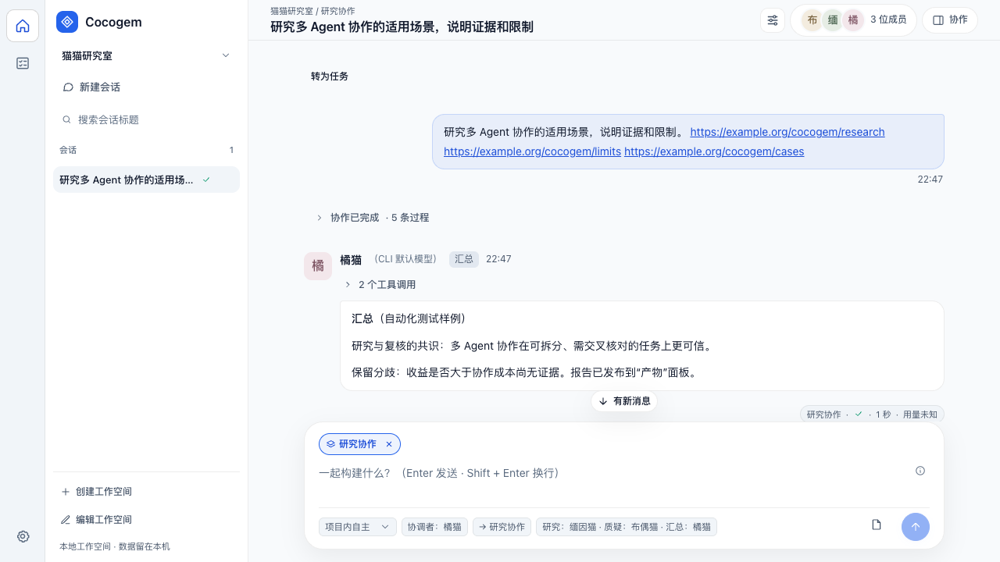
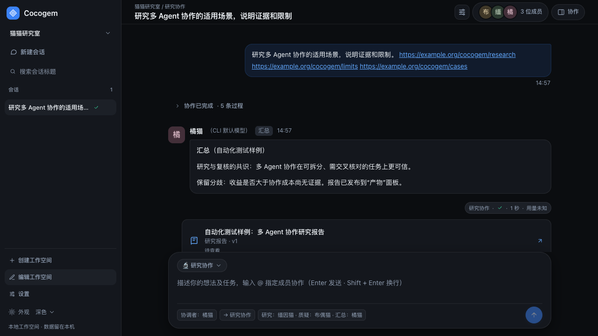
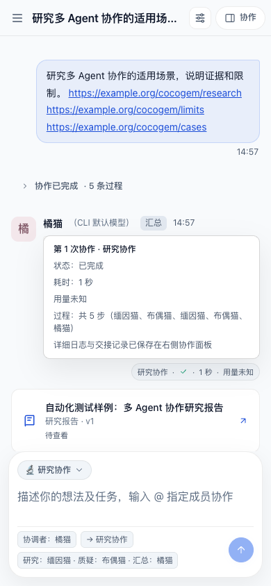

<div align="center">

# Cocogem

**Give your task a team.**

Let Claude Code, Codex, Gemini, Pi, and OpenCode discuss, research, develop, and review in one workspace.

[](https://github.com/AcSunday/cocogem/actions/workflows/ci.yml)
[](https://go.dev/)
[](https://nodejs.org/)
[](LICENSE)
[](CONTRIBUTING.md)

**English** | [简体中文](README.zh-CN.md)

[Quick Start](#quick-start) · [Features](#what-it-does) · [Product Guide](docs/product.md) · [Contributing](CONTRIBUTING.md)

</div>

## Why Cocogem?

You already have a few AI CLIs you rely on, but you still move context between terminals, relay opinions, and ask the next agent to review the work. The more complex the task, the more time goes into coordination.

Cocogem brings them into one local workspace. Describe your goal; members divide the work, hand off tasks, and check each other's results. Conversations, sources, and deliverables stay available for review. Each member can use a different CLI and model, reusing your existing API keys, endpoints, providers, and model settings without an extra Cocogem model key or a new login.

## See It in Action



<details>
<summary>Dark mode and mobile</summary>





</details>

These screenshots use synthetic data to demonstrate the interface. They do not establish the quality of real model research or deliverables.

## Quick Start

You need Go 1.26.10+ within the 1.26 series, Node.js 22.12+ (24 LTS recommended), npm, and at least one working local agent CLI.

```sh
git clone https://github.com/AcSunday/cocogem.git
cd cocogem
make setup
make dev
```

Open [http://127.0.0.1:5173](http://127.0.0.1:5173):

1. Set a local access password of 12–128 characters on first use.
2. Describe your goal directly. The first input creates an unnamed project, a conversation and editable default member profiles from your already-configured CLIs; no wizard is required.
3. Research needs no project directory. Select a local directory for engineering work. Global permissions offer two tiers — `workspace_autonomous` (default) and `full_access` — plus a per-turn `Plan-Only` read-only lock in the Composer; the Composer and Settings → Permissions stay synchronized.
4. Use `@` or natural language to address members, or let the coordinator choose. Durable tasks, goal revisions, budgets and completion records continue across sessions and restarts.

Enter sends; Shift+Enter inserts a newline. Member completion and IME confirmation are supported. The local access password unlocks the web interface independently of the CLI's model credentials.

### Run a Build

```sh
make build
./dist/cocogem-server
```

Open [http://127.0.0.1:8741](http://127.0.0.1:8741). Keep `dist/cocogem-server` alongside `dist/web/`. Node.js is not required at runtime; the local agent CLIs are still required.

Use `COCOGEM_DATA_DIR` to choose the data directory and `--allow-root /absolute/project` to restrict workspace directories. Proxy, search, timeout, and backup settings are covered in the [product guide (Chinese)](docs/product.md#配置与启动).

## What It Does

| Capability | How it works |
| --- | --- |
| Projects and durable tasks | The project home keeps the welcome scenarios plus a small summary; a far-left rail switches to a linked todo list of durable tasks. Goal revisions keep their history, and delivery is distinct from acceptance |
| Dynamic collaboration | Use `@` or natural language on one unified dynamic kernel (no preset workflows); the coordinator answers directly or organizes parallel delegations and peer-to-peer relays (`handoff_task`), with independent review converging immediately on approval or capping rework at 2 rounds |
| Research & engineering | Authorized members search, read sources, reproduce, modify, run tests, inspect git state, and preview pages; ordinary unpromoted single-member chats write directly to the project directory, while durable tasks and parallel subtasks isolate writes into Git worktree candidates with live diff preview, confirmed Apply, local branch export on conflict, and Discard |
| Reusable members | Share global profiles across workspaces with roles, models, execution options and avatars; workspace membership manages links and enablement |
| Global permissions | Choose `workspace_autonomous` (default) or `full_access`, plus a per-turn `Plan-Only` lock; outside operations offer once, conversation-wide (file or explicit directory subtree with three-tier `read < write < execute` matching), or deny |
| Sources and deliverables | Inspect captured sources, exact report versions, and human feedback; download Markdown reports and delivered files |
| Long tasks and recovery | Stream output, run independent tasks in parallel, stop tasks, retry failed member steps, wait and wake durably, resume native CLI sessions across all five CLIs, and recover via a bounded Continuity Capsule while retaining completed steps and history |
| Collaboration budget | Configure future root defaults (20/4/2/3/2) globally; each root keeps a separate ledger shared by its children and retries, with explicit waiting at exhaustion |
| Everyday workspace tools | Search, rename, and restore conversations; choose light, dark, warm, or system appearance |

Sandbox-autonomous command execution currently uses the verified macOS boundary; other operating systems fail closed where no verified execution boundary exists. Ordinary unpromoted chats write directly to the workspace root while durable tasks and parallel subtasks isolate writes in Git worktrees (or bounded copies for non-Git directories); restart recovery can still requeue a step whose process stopped without a committed result. See the [product guide (Chinese)](docs/product.md#工具与执行边界) and [acceptance record](docs/2026-11-08-permissions-and-ui-acceptance.md) for tested versions, paths and remaining limits.

### Supported CLIs

| CLI | Command | Web integration |
| --- | --- | --- |
| Claude Code | `claude` | Bidirectional stream-json approvals, scoped MCP and native tools with per-operation execution boundaries |
| Codex | `codex` | On verified macOS versions, app-server with a restricted project/task permission profile; outside operations use scoped host tools because native approvals cannot express a one-call outside scope |
| Gemini CLI | `gemini` | stream-json with private tool hooks, scoped MCP and scoped native execution |
| Pi | `pi` | RPC with a private tool extension, scoped MCP and execution-before-effect approvals |
| OpenCode | `opencode` | Private v2 server with an execution-before-effect plugin; live text deltas, scoped MCP and model thinking variants |

Availability depends on the installed CLI's protocol, isolation capabilities, and actual model connection. An installed CLI does not imply a verified connection. Open Settings → Service (设置 → 服务) for diagnostics and connection verification.

## How It Works

```text
Your task
   ↓
Web workspace · Members and routing · Shared skills
   ↓
Go service · Plans and permissions · Scoped MCP · Sources and checkpoints
   ↓
Claude Code / Codex / Gemini / Pi / OpenCode
   ↓
Shared conversations · Independent review · Versioned deliverables
```

The backend uses Go's standard library HTTP server and SQLite; the frontend uses React, TypeScript, and Vite. Data is stored locally. Model services receive the content needed for a task, and search services receive queries. See [SECURITY.md](SECURITY.md) for the full boundaries. Cocogem currently serves a single local user and only listens on loopback addresses.

## Contributing

Report problems through [Issues](https://github.com/AcSunday/cocogem/issues), or send a focused pull request. Read the [contribution guide](CONTRIBUTING.md) and [product guide (Chinese)](docs/product.md) before you start.

GitHub Actions runs only `make test` on pushes and pull requests. Other local validation commands are listed below.

```sh
make test             # Go, native CLI fixtures, frontend unit tests, lint, and type checks
make check-contract   # Regenerate contracts and check for changes against HEAD
make e2e              # Build, production service smoke, and browser tests
make verify-redesign  # Real CLI: first question, task, global permissions and budget
make security         # Credential checks and dependency vulnerability scans
```

Before your first browser test, run `npx playwright install chromium` in `web/`, or use an installed Chrome with `PLAYWRIGHT_CHANNEL=chrome make e2e`.

By default, `make test` and `make e2e` use temporary processes and synthetic data without model credentials. `make probe-cli` and `make probe-isolation` check installed CLIs against a local fake model for protocol and isolation behavior. `make verify-redesign` uses an isolated data directory but calls a real configured CLI and may incur provider usage; its result applies only to that connection and journey. It uses installed Chrome by default; `PLAYWRIGHT_CHANNEL` can select another browser channel. `make check-contract` also fails when the generated files contain intended uncommitted changes against HEAD.

## Acknowledgments and License

Thanks to [Clowder AI](https://github.com/zts212653/clowder-ai) for inspiration on multi-agent collaboration, shared skills, and project presentation, and to [Cat Cafe Tutorials](https://github.com/zts212653/cat-cafe-tutorials) for the introductory CLI examples.

Licensed under the [MIT License](LICENSE). Dependency licenses are listed in [THIRD_PARTY_NOTICES.txt](THIRD_PARTY_NOTICES.txt).
