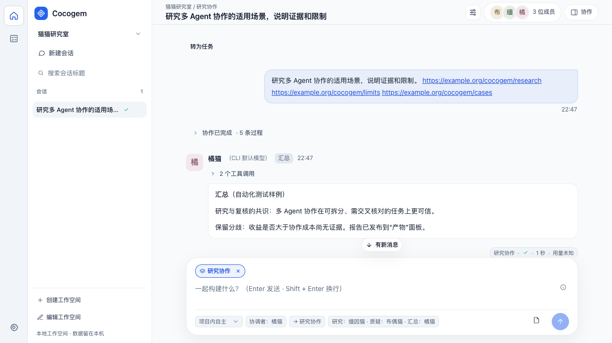
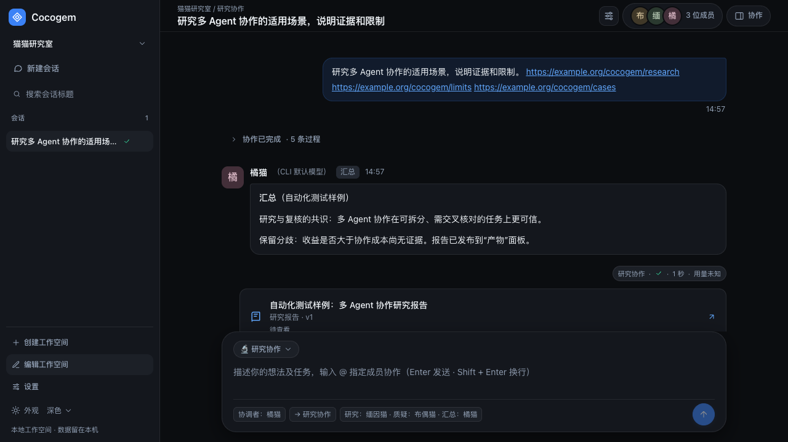
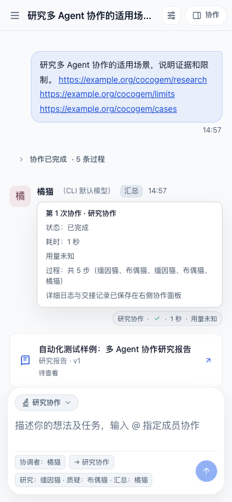

<div align="center">

# Cocogem

**把问题交给一个团队。**

让 Claude Code、Codex、Gemini、Pi 和 OpenCode 在同一个工作空间里讨论、研究、开发与复核。

[](https://github.com/AcSunday/cocogem/actions/workflows/ci.yml)
[](https://go.dev/)
[](https://nodejs.org/)
[](LICENSE)
[](CONTRIBUTING.md)

[English](README.md) | **简体中文**

[快速开始](#快速开始) · [功能](#能做什么) · [产品文档](docs/product.md) · [参与贡献](CONTRIBUTING.md)

</div>

## 为什么做 Cocogem？

你已经有几个常用的 AI CLI，却还要在终端之间搬运上下文、转述意见、催下一位成员复核。任务越复杂，这些协调工作越容易淹没问题本身。

Cocogem 把它们放进同一个本地工作空间：你描述目标，成员分工、交接并检查彼此的结果，最后留下可回看的对话、来源和交付物。成员可以使用不同的 CLI 和模型，复用你已有的 API Key、服务地址、供应商及模型设置，无需额外的 Cocogem 模型密钥或重新登录。

## 看看界面



<details>
<summary>深色与移动端</summary>





</details>

界面示例使用合成资料，展示产品交互；不代表真实模型的研究或交付质量。

## 快速开始

准备 Go 1.26.10+（1.26 系列）、Node.js 22.12+（建议 24 LTS）和 npm，以及至少一个已能正常使用的本机 CLI。

```sh
git clone https://github.com/AcSunday/cocogem.git
cd cocogem
make setup
make dev
```

打开 [http://127.0.0.1:5173](http://127.0.0.1:5173)：

1. 首次使用时设置 12–128 字符的本地访问密码。
2. 直接输入目标。首次输入会在同一事务中创建「未命名项目」、会话和可编辑的默认成员档案；复用已配置的 CLI，不要求先完成成员或项目向导。
3. 研究不需要工程目录；工程工作就地选择目录。权限全局统一，首次初始化及旧模型一次性迁移默认「项目内自主」，输入框与「设置 → 权限」同步，新空间沿用当前选择。
4. 用 `@` 指定成员，或用自然语言描述如何协作。持久任务、目标修订、预算和验收记录可跨会话、跨重启继续。

Enter 发送，Shift+Enter 换行；支持中文输入法确认和成员补全。本地访问密码只用于解锁网页，与 CLI 的模型凭据独立。

### 构建后运行

```sh
make build
./dist/cocogem-server
```

打开 [http://127.0.0.1:8741](http://127.0.0.1:8741)。运行时保留 `dist/cocogem-server` 与同目录的 `dist/web/`；无需 Node.js，仍需本机 CLI。

可用 `COCOGEM_DATA_DIR` 指定数据目录，用 `--allow-root /absolute/project` 限制可绑定的工程范围。代理、搜索、超时与备份配置见[产品文档](docs/product.md#配置与启动)。

## 能做什么

| 能力 | 使用方式 |
| --- | --- |
| 项目与持久任务 | 项目首页保留欢迎场景和少量摘要；最左侧窄栏可切换到与真实任务联动的 todo list。目标修订保留不可变历史，交付不等于验收 |
| 自由协作 | 用 `@` 或自然语言发起任务，协调者可在同轮立项并直接回答、发起并行委派或点对点接力 A2A（`mode="relay"`，如执行者完成后直接唤起复核者，无异议一轮即停，有问题再接力返工），或选择内置流程 |
| 协作讨论 | 成员先独立思考，再交叉质疑与汇总，保留真实分歧；无表述争议时自动跳过冗余核对轮次 |
| Research | 检索和阅读资料并经独立质疑；首轮核查证据充分时直接进入报告汇总，有异议再逐项回应与复查 |
| 工程协作 | 授权成员读取、复现、修改和测试后由另一成员独立复核：一审通过直接收敛交付，存在缺陷时按需返工（最多 3 轮）并交付工程报告 |
| 可复用的成员 | 全局成员可加入多个空间，配置职责、模型、执行选项及头像；空间关系只管理加入与启用 |
| 全局权限 | 受控、项目内自主或完全访问；额外操作可仅允许本次、在本会话持续允许或拒绝，持续授权仍限定工具和资源范围 |
| 来源与交付物 | 查看捕获来源、确切报告版本和人工反馈，下载 Markdown 报告及实际交付文件 |
| 长任务与恢复 | 实时输出、独立任务并行、停止、失败成员步骤重试、持久等待/唤醒和检查点恢复，保留已经完成的步骤与历史 |
| 协作预算 | 全局配置未来根任务的 20/4/2/3/2 默认值；每根独立累计，子任务与重试共享所属账本，预算耗尽时明确等待 |
| 日常工作空间 | 会话搜索、重命名、回收站，浅色、深色、暖色及跟随系统的外观 |

项目内自主的命令执行目前采用 macOS 执行边界；其他未验证平台明确失败关闭。写入不保证总是在独立候选目录中进行；重启恢复可能重新排队进程已停止但结果未提交的步骤。具体权限、安装版本、测试路径与剩余限制见[产品文档](docs/product.md#工具与执行边界)和[验收记录](docs/2026-11-08-permissions-and-ui-acceptance.md)。

### CLI 接入

| CLI | 本机命令 | Web 接入方式 |
| --- | --- | --- |
| Claude Code | `claude` | 双向 stream-json 审批、受限 MCP，原生工具按次落实执行边界 |
| Codex | `codex` | 已验证的 macOS 版本使用 app-server 与项目/任务窄权限配置；原生协议无法表达按次外部范围，项目外操作由范围受限的宿主工具承接 |
| Gemini CLI | `gemini` | stream-json、私有工具 hooks、受限 MCP 与确切范围的原生执行 |
| Pi | `pi` | RPC、私有工具扩展和受限 MCP，在原生效果发生前审批 |
| OpenCode | `opencode` | 独立 v2 服务与私有执行前插件，实时正文、受限 MCP 和模型思考变体 |

接入是否可用取决于安装版本的协议、隔离能力及实际模型连接；「已安装」不等于「连接已验证」。在「设置 → 服务」查看诊断和验证连接。

## 如何工作

```text
你的任务
   ↓
Web 工作空间 · 成员与路由 · 共享技能
   ↓
Go 服务 · 计划与权限 · 受限 MCP · 来源与检查点
   ↓
Claude Code / Codex / Gemini / Pi / OpenCode
   ↓
共享对话 · 独立复核 · 版本化交付物
```

服务使用 Go 标准库 HTTP 和 SQLite，前端使用 React、TypeScript 和 Vite。数据保存在本机，模型服务会收到执行任务所需的内容，搜索服务会收到查询；完整边界见 [SECURITY.md](SECURITY.md)。当前面向本地单用户，服务只允许监听回环地址。

## 参与开发

欢迎通过 [Issues](https://github.com/AcSunday/cocogem/issues) 反馈问题，或提交聚焦的 Pull Request。开始前请阅读[贡献指南](CONTRIBUTING.md)和[产品文档](docs/product.md)。

GitHub Actions 在 push 和 Pull Request 时只执行 `make test`。其他验证命令保留为本地入口。

```sh
make test             # Go、原生 CLI fixture、前端单元测试、Lint 与类型检查
make check-contract   # 重新生成契约并检查相对 HEAD 的差异
make e2e              # 构建、正式服务 smoke 与浏览器测试
make verify-redesign  # 使用真实 CLI 验证首问、任务、全局权限和预算
make security         # 凭证检查与依赖漏洞扫描
```

首次运行浏览器测试，在 `web/` 下执行 `npx playwright install chromium`；也可用 `PLAYWRIGHT_CHANNEL=chrome make e2e` 使用已有 Chrome。

`make test` 和 `make e2e` 默认使用临时进程与合成资料，不需要模型凭据。`make probe-cli` 和 `make probe-isolation` 可检查已安装 CLI 与本地假模型的协议及隔离行为。`make verify-redesign` 使用隔离数据目录，但会调用已配置的真实 CLI，可能产生供应商用量；结果只适用于该次连接和测试旅程。该命令默认使用已安装的 Chrome，可通过 `PLAYWRIGHT_CHANNEL` 选择其他浏览器 channel。`make check-contract` 也会因生成文件存在预期的未提交改动而失败。

## 致谢与许可

感谢 [Clowder AI](https://github.com/zts212653/clowder-ai) 对多 Agent 协作、共享技能及项目介绍方式的启发，以及 [Cat Cafe Tutorials](https://github.com/zts212653/cat-cafe-tutorials) 的 CLI 入门示例。

采用 [MIT License](LICENSE)。第三方依赖许可见 [THIRD_PARTY_NOTICES.txt](THIRD_PARTY_NOTICES.txt)。
