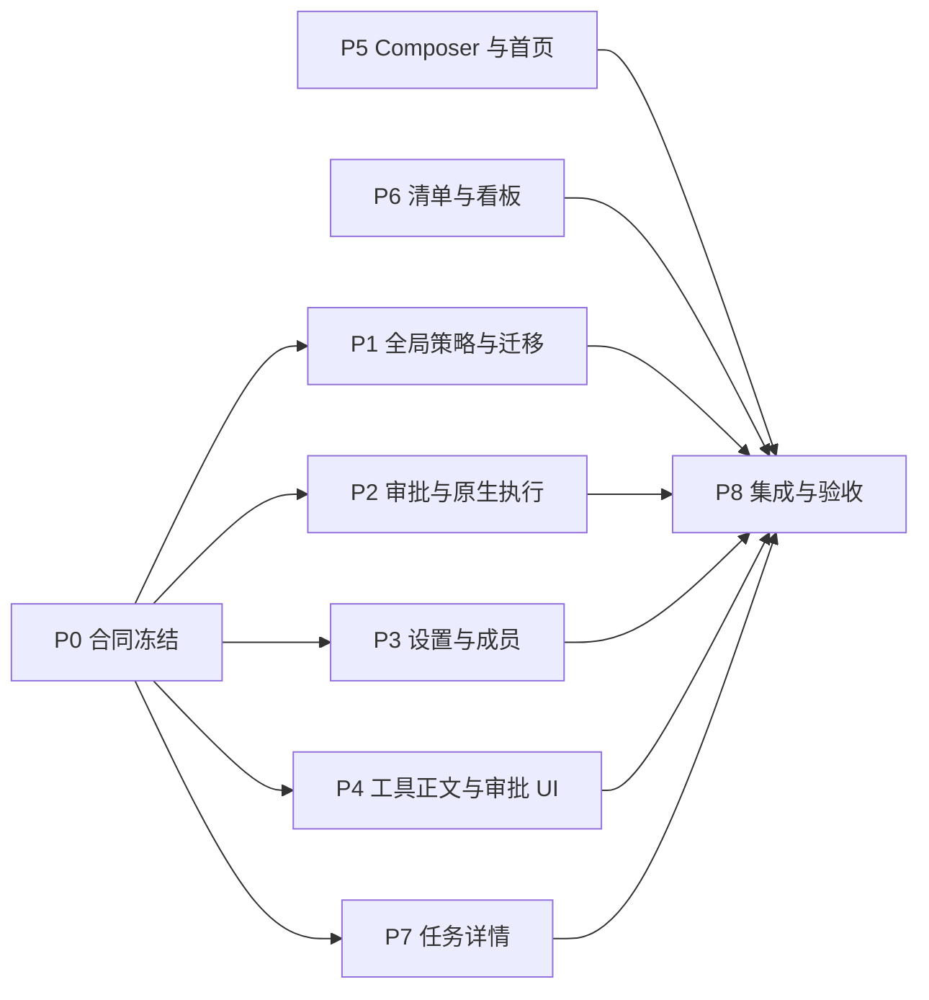

# 全局权限、执行交互与任务界面改造

日期：2026-11-08

状态：**需求已确认，已按本合同实施并完成本机验收；具体通过范围、原生协议能力缺口与未验证项以[验收记录](2026-11-08-permissions-and-ui-acceptance.md)为准。** 本文件保留目标合同，不能单凭这里的目标宣称全部平台或供应商能力已交付。

适用仓库：Cocogem。核对基线为 `a1496dc2b8616828bcd874b79e4bbe13e4a5b976` 及当前工作区已有改动；实现前重新记录基线。

## 1. 执行入口与范围

本文件汇总用户的 19 条浏览器批注、4 项功能要求及后续逐项确认，供 OpenCode 实现、Codex 验收。第 11 节给出工作包和依赖，第 12 节给出逐项验收标准，第 13 节给出交接指令。

先读 `AGENTS.md`、`docs/product.md`、`docs/redesign.md`，再按本文件执行。本轮明确改变的目标以本文件及用户最新确认优先：全局权限、首次及旧数据迁移默认项目内自主、移除成员工具授权配置、移除任务设置、移除任务页参考来源。其他既有任务身份、不可变历史、重试、文件交付、Web 登录和路由契约继续适用。

当前工作区有大量已跟踪与未跟踪改动。不得清理、覆盖或把它们当作本轮成果提交；尤其不能用 `reset --hard`、`clean` 或整文件回退整理基线。并行工作必须先划定文件所有权。新功能通过相应检查后才能提交，提交信息使用 Conventional Commits。

本轮完成某阶段并验证后，再更新 `docs/product.md` 及 `AGENTS.md` 的对应现行规则。`docs/redesign.md` 中被本合同替代的旧目标应在落地阶段标注替代关系。不得提前把计划写成现行行为。

### 1.1 已确认的产品决定

| 编号 | 决定 |
| --- | --- |
| D01 | 权限是整个本地产品共享的一份全局配置，不再按工作空间保存或覆盖。Composer 与设置中的权限入口读写同一个状态。 |
| D02 | 首次初始化的默认权限是 `project_autonomous`。旧空间无论原来是哪一档，首次迁移统一为该档。以后创建空间沿用当时全局值，不重置权限。 |
| D03 | 协作预算在“设置 → 协作”统一配置；每个根任务分别累计，子任务、续办与重试共享所属根账本。不是全部任务共用一个总额度。 |
| D04 | 移除成员编辑中的“全局允许工具”和空间成员中的“本工作空间权限”；成员是否启用、是否加入空间仍保留。 |
| D05 | 受控模式沿用当前标准成员工具模板与受控规则，缺少的可申请权限由执行时申请。项目内自主允许项目范围内操作和原生 CLI 工具，超范围申请。完全访问保持现有原生 CLI 放开行为。 |
| D06 | 项目内自主下，项目内读写、命令、联网检索和项目内依赖安装自主执行；项目外文件读写、系统软件安装、发布和部署需授权。CLI 正常读取自身配置和运行依赖不反复申请。 |
| D07 | 授权有“仅本次允许”“本会话持续允许”“拒绝”三种结果。会话持续授权由该会话内所有成员共享，但仍限定申请的工具/动作和资源范围。 |
| D08 | 工具执行状态展示在会话正文中，默认折叠；移除协作侧栏“过程”，保留其“来源”和“成果”。 |
| D09 | 移除任务详情内嵌的“验收交付”折叠区；保留“去验收”人工入口，改为打开验收弹窗，不取消人工验收机制。 |
| D10 | “任务设置”及该区域的内容直接废弃，不移到更多菜单或其他设置页。任务页的暂停、取消、目标编辑等手动设置入口一并清理。 |
| D11 | 彻底移除任务页“参考来源”功能和专用处理逻辑；会话协作侧栏来源不受影响。成果文件下载、历史证据及共享来源基础设施继续有效。 |

### 1.2 继续成立的约束

- Web 是唯一产品入口；实现放在 `internal/`，原生适配在 `internal/nativecli/`，不得新增独立终端产品命令。
- Go 使用 1.26.9 或更新的 1.26 版本、标准库 HTTP、显式构造注入；Go 工作加载 `cc-skills-golang:golang-how-to` 及适用技能。
- 复用本机已有 CLI 的 API Key、endpoint、provider、model；不得要求额外登录或 Cocogem 凭据。Web 密码与 CLI 身份独立。
- 保留成员、会话、Task、TaskRevision、Run、Step、Attempt 身份和历史；不得重写旧消息、旧授权快照或旧验收记录。
- 只读任务、独立 reviewer/critic 的职责限制继续生效。全局模式决定执行边界，不把审核角色变成可修改作者结果的执行角色。
- 保留 IME、Enter/Shift+Enter、`@`/`/` 补全、附件发送前暂存、精准成员重试、不可变实际文件下载和根预算不重置。
- 对无法核实的原生执行副作用，不自动重放整个 CLI、成员步骤或根任务。

## 2. 已核对的实现差距

以下是编写合同前的代码观察，不能作为改造后的验收结果。

| 位置 | 当前实现 | 本轮需要改变 |
| --- | --- | --- |
| `internal/workspace/types.go`、`internal/store/settings.go` | `Settings` 有协作预算，没有全局执行模式；模式与预算覆盖位于 Workspace。 | 全局配置成为唯一有效来源，完成一次性迁移。 |
| `internal/store/members.go` | `effectiveAgent` 计算 `Agent.Tools ∩ WorkspaceMember.Tools`。 | 移除旧配置作为活动权限上限的作用，使用统一权限决策。 |
| `internal/project/authorization.go` | 从 Workspace 读取模式，项目内自主实际回退为受控。 | 全局模式、操作授权、原生边界真正参与执行。 |
| `internal/nativecli/provider.go`、`native.go` | 原生广泛工具主要在 full_access 开放。 | 实现项目内自主的受约束原生工具及执行前授权。 |
| `internal/nativecli/opencode_events.go` | `permission.asked` 目前会终止为权限错误。 | 适配真实审批请求/回应，不能在收到事件后直接失败。 |
| `SettingsDialog.tsx`、`ProjectSettings.tsx`、`App.tsx` | 全局设置、空间设置和 Composer 分别管理部分权限/预算。 | 统一状态与保存逻辑，清理空间入口及旧补权提示。 |
| `Composer.tsx` | 提示图标依赖 `title`，hover 有背景；placeholder 包含路由提示。 | 可测试的提示浮层、透明背景、简化文案。 |
| `TaskBoardPage.tsx`、`project.module.css` | 看板沿用清单最大宽度；卡片正文和操作区分离；信息较多。 | 满宽看板、统一卡片交互、精简字段。 |
| `TaskDetail.tsx` | “去验收”仅展开并滚动到内嵌表单；来源筛选也用于验收证据选项。 | 验收弹窗；清除任务页来源展示、派生与证据选项。 |
| `ContextPanel.tsx` | `PanelTab` 有 `sources / artifacts / tools`。 | 删除 tools 分支及专用数据处理，工具状态回到正文。 |

文件名在本文中省略 `web/src/components/` 前缀时均指该目录；实际改动前核对最新代码，不按旧行号机械替换。

## 3. 全局权限与预算合同

### 3.1 唯一配置与同步

扩展 `Settings`：

```text
execution_mode: controlled | project_autonomous | full_access
permission_epoch: integer >= 1
collaboration_budget: 现有五项 BudgetPolicy
revision: 既有设置 CAS 版本
```

- 继续使用 `GET /api/v1/settings`、`PATCH /api/v1/settings`，PATCH 使用 `If-Match`。
- PATCH 必须是字段合并语义。仅修改权限不能清空分工、默认协调者、回收站周期或预算；协作设置保存也不能把权限恢复为旧值。
- `permission_epoch` 只在执行权限边界变化时递增，普通外观、预算或分工变化不使授权失效。
- Composer、新的“设置 → 权限”、初始化与实际执行读取同一全局来源。不得继续取 `workspace.execution_mode`，也不得以 localStorage 作为权限真值。
- 当前窗口保存成功后两个入口立即同步；切空间不改变选择。失败时恢复服务端值并在现有 Composer notice 或设置页显示真实错误，不改变草稿。
- 多窗口至少通过保存后的广播、窗口聚焦重新读取及可见时的有界刷新同步；两个同时可见窗口应在 2 秒内一致。广播只提示刷新，服务端仍是权威。
- 无工作空间时也可以设置全局权限；新建空间不能覆盖已保存值。

### 3.2 执行时的模式边界

| 行为 | 受控 | 项目内自主 | 完全访问 |
| --- | --- | --- | --- |
| 默认宿主工具 | 沿用现有标准模板及其受控/角色约束 | 按任务可用 | 按任务可用 |
| 项目内文件读写、测试 | 服从现有受控规则；不满足时可申请 | 自主 | 自主 |
| 原生 CLI 通用文件/命令工具 | 需要时申请具体范围 | 项目范围内自主 | 保持当前放开方式 |
| 项目内依赖安装 | 超出当前受控授权时申请 | 自主，缓存/临时目录须受限 | 自主 |
| 公共联网检索 | 允许已有检索/抓取路径 | 自主 | 自主 |
| 项目外文件读写 | 申请确切范围 | 申请确切范围 | 按现有完全访问行为 |
| 系统软件安装、发布、部署 | 申请 | 申请 | 按现有完全访问行为 |
| CLI 连接配置及正常运行依赖读取 | 由适配器正常转发 | 正常转发 | 正常转发 |
| 人工独立审核/只读角色限制 | 保留 | 保留 | 保留 |

受控模式的“默认配置”不得随意重新发明。当前标准模板目录为：

```text
list_files, read_file, view_image, search_content,
web_search, fetch_url, read_source, publish_artifact, publish_file,
write_file, patch_file, run_test, run_command
```

这是当前全局成员表单的默认能力目录，不表示通用命令和所有资源在受控模式下均无条件执行。沿用既有工具的真实实现及任务/角色约束；把原先的工具缺权终止改成可申请的执行分支。协作控制工具仍由宿主按当前会话/任务注入，不归成员工具复选框管理。

权限计算改为“全局模式 + 当前任务/角色约束 + 当前会话的操作授权 + 适配器实际执行能力”。成员加入/启用检查继续执行。旧 `Agent.Tools`、`WorkspaceMember.Tools` 不得留下活动的隐藏交集，否则删除 UI 后用户将无法解除旧限制。

本轮对全局模型的明确确认，是替换旧成员工具配置的授权。旧工具值可作为迁移前审计数据保留，不再决定迁移后新执行的上限；旧 Run 的历史快照不改写。语义只读和审核限制不靠这些旧数组推断。

### 3.3 运行中切换

- 新 Run 固定记录启动时的模式和 epoch；每次派发、真正调用工具及原生执行准入前检查实时 epoch。
- 权限收紧先禁止新的越权准入，停止无法在原进程内收紧的原生执行。未能核实进程/效果时标为待核实，不能显示已安全停止或自动重跑。
- 权限提升对新执行生效，不静默扩大已启动 Attempt 的边界；已有等待中的具体操作可通过第 4 节独立审批继续，必须有新的授权记录。
- 模式切换使尚未决定的旧 epoch 请求失效，并撤销旧 epoch 的会话扩权授权；UI 明确提示请求需要重新评估，不能对旧授权自动补发。
- 切换不得重置任务预算、覆盖历史快照或创建重复任务。

### 3.4 全局预算

- 保留现有五项、默认值与合法范围：自动续办 20、并行分支 4、写分支 2、修复轮数 3、连续无进展 2；写分支不能大于总分支。
- 只在“设置 → 协作 → 协作预算”配置未来根任务默认值。
- 新根任务读取最新全局配置，空间不再覆盖；已有根账户的 policy、used、reserved 及子任务关联保持不变。
- 移除空间预算覆盖编辑及新建任务时的覆盖解析；不能把旧空间覆盖继续作为隐藏默认值。
- 移除任务设置中的预算编辑、跳转与表单。预算耗尽仍按真实账本停止自动续办，说明原因；不能保留指向已删除表单的“调整预算并继续”。此时主动作可打开关联会话，不能假称修改全局默认值会解锁旧账本。

## 4. 执行时授权闭环

### 4.1 请求与决定

新增持久操作审批对象，建议 `ToolPermissionRequest` 与 `ConversationGrant`。具体 Go 文件名可调整，但以下信息及语义必须覆盖：

```text
ToolPermissionRequest:
  id, thread_id, workspace_id, run_id, step_id, attempt_id, member_id
  tool_call_id, origin(host/native), adapter, action, tool_name
  normalized_resource_scope, arguments_digest, reason, permission_epoch
  status(pending/allowed_once/allowed_conversation/denied/expired/canceled)
  request_id, created_at, resolved_at, revision

ConversationGrant:
  id, thread_id, action/tool_matcher, normalized_resource_scope
  permission_epoch, source_request_id, status, created_at, revoked_at

ToolInvocationAdmission（可使用独立记录或现有 EffectRecord 承载）:
  id, permission_request_id/grant_id, run_id, step_id, attempt_id, tool_call_id
  arguments_digest, permission_epoch, reserved_at, started_at, settled_at
  status(reserved/started/completed/failed/unknown), result_ref
```

- 后端产生结构化范围和参数摘要，不能把模型任意字符串直接变成授权范围。
- 单次授权绑定确切操作、参数摘要与资源，不得变成同类工具的一次任意调用；消费准入使用事务/CAS。
- 单次授权的消费/执行记录必须持久化，并以授权和确切调用身份设置唯一约束。重复决定返回原决定，重复准入返回已有状态/结果，不再次执行。崩溃后 `reserved/started` 不能简单恢复为可用授权；先核实效果，无法核实时记为 unknown，不自动重放。
- 会话持续授权以 `thread_id` 为边界，不限定申请成员。A 成员获准后，B 成员在同会话请求同动作与同范围可直接使用；B 的只读/审核角色限制仍不可绕过。
- 更换路径、扩大目录、改变命令效果类别、不同会话或不同工作空间均不能复用不匹配授权。
- 自动子任务若使用内部独立 thread，不因共享根任务自动继承授权；同一 thread 内的成员交接可共享。
- 会话持续授权跨页面刷新、服务重启继续有效，直到撤销、权限 epoch 变化或会话删除。移除成员不删除历史记录，失去成员关系者不能继续使用。
- 在“设置 → 权限”提供按会话查看与撤销持续授权的紧凑入口；这不是空间/成员权限配置页。

建议 HTTP 合同，先在工作包 P0 冻结，生成类型后供前端并行使用：

| 接口 | 语义 |
| --- | --- |
| `GET /api/v1/threads/{id}/permission-requests` | 当前会话待决定请求及有界历史。 |
| `POST /api/v1/permission-requests/{id}/decisions` | `{decision: allow_once / allow_conversation / deny, request_id}`，带 `If-Match`；范围只能取原请求。 |
| `GET /api/v1/threads/{id}/permission-grants` | 当前会话持续授权。 |
| `POST /api/v1/permission-grants/{id}/revoke` | 幂等撤销，阻止后续准入并核实受影响执行。 |

沿用本地 Web 认证及现有错误结构。不同会话/Run/Attempt 的错配请求、重复冲突决定、过期 epoch 必须拒绝，不靠前端禁用按钮保证。

### 4.2 用户交互

- 请求出现在当前会话的执行位置，并提供清晰的待处理卡片/弹窗。待授权是阻塞状态，不藏在默认折叠日志内。
- 展示申请成员、操作、目标范围、简短原因。文件显示真实规范化路径；命令显示足够判断作用的内容；不展示密钥。
- 三个动作固定为“仅本次允许”“本会话持续允许”“拒绝”，持续允许旁说明同会话所有成员共享。
- 点击允许只推进这个尚未执行的操作，不提交 Composer 草稿，不重启根任务。拒绝返回明确结果给成员，由成员采用替代方案或结束相应步骤。
- 关闭/按 Escape 不是拒绝或允许，保持待处理；可稍后从同会话待处理提示重新打开。
- 多请求排队展示，当前请求不得被后到请求覆盖。双击、重复网络投递、刷新后再次点击均不能多执行一次。
- 已失效、已决定、已撤销状态可读但不可再次决定。
- 等待人工决定不是 CLI 无响应失败；挂起相应无响应判定，不因此自动重试、续办或耗尽无进展预算。服务重启后先核实原进程及操作是否尚未执行，再恢复待处理请求。

### 4.3 真实执行边界

此部分是功能实现，不能用提示词、工作目录或解析输出后的报警代替：

1. 所有宿主工具通过统一权限决策；可申请工具必须能被模型发现，例如现有 scoped MCP 中提供有界 `request_tool_access`，或返回带可恢复申请标识的结构化结果。不得只从工具目录删除后宣称支持申请。
2. 原生工具在产生效果**之前**拦截：优先使用安装版 CLI 的真实 permission 请求/响应协议；没有对应协议时，调整适配路径或增加真正的执行约束层。先验证接口，不能假定五种 CLI 都支持同一种 hook。
3. 项目内自主的目录边界覆盖绝对路径、`..`、符号链接、硬链接及子进程。规范化后比较真实目标，不以“字符串以项目路径开头”判定。
4. 项目范围包括绑定目录、宿主管理的该任务候选/验证目录、明确授权的附件副本、输出与隔离临时目录。没有绑定目录的文件任务使用其任务目录，不得以空根或用户 HOME 代替。
5. CLI 身份、endpoint 与运行所需配置由适配器复用/转发；它们的正常读取不等于给模型开放整个用户配置目录，也不能把其他 CLI 历史与全部环境注入项目。
6. 区分正常模型 API 连接、公共检索、项目依赖下载与发布/部署。任意 shell 的网络副作用不能只靠命令名或模型自述分类；需要有可验证的适配器审批与实际约束。公开网络可达不能被描述成“已限制所有外部写操作”。
7. 等待授权不得持有 SQLite 写事务、数据库锁或全局互斥锁。记录后等待决定，仅挂起受影响操作，独立成员可继续。
8. 已开始且效果不确定的原生过程不能变成可重放的“待授权操作”。只有执行前尚未发生效果的调用才能在批准后继续。
9. 不具备边界或协议证据的 adapter×OS 明确显示能力缺口，并阻止不受约束的操作；不能偷偷使用 full_access，也不能把全盘受控回退算作项目内自主已完成。

当前环境优先验收 macOS 与实际可用 CLI。Claude/Codex/Gemini/Pi/OpenCode 分别记录版本、协议路径、正反例和结果；安装、协议 fixture、真实供应商任务是三种不同证据。没有实机的组合标为未验证，不能打完成勾。

## 5. 设置、工作空间和成员界面

### 5.1 全局设置

- 设置分类新增独立“权限”，与成员、协作、外观同级。
- 三档名称保持“受控 / 项目内自主 / 完全访问”；说明使用第 3.2 节的用户动作边界，不展示内部 epoch、Grant 或适配器参数。
- 权限页与 Composer 联动，复用同一保存入口和错误处理；保存协作预算不能覆盖权限。
- “协作”仅负责全局分工与全局预算默认值；分工继续优先使用显式指派与当前可用成员。

### 5.2 编辑工作空间

- 移除整个“权限与预算”、模式选择、空间预算覆盖、成员任务执行补权及空间持续授权管理区。
- 清理 `ProjectSettings.tsx` 专用请求、加载状态、旧说明与仅供这些区域使用的组件/样式。若组件没有剩余职责，连同调用一起移除。
- 空间名称、说明、工程目录绑定等仍有实际用途的编辑功能保留；不得因删除权限卡误删空间基本资料。
- 旧 `/workspaces/{id}/execution-policy`、`budget-policy`、`file-execution` 等写入口不再能改变运行权限。删除无剩余用途的路由；如迁移兼容需要短期保留，明确返回废弃错误并移出正常客户端，不保留可生效的第二套配置。

### 5.3 成员

- 全局成员创建/编辑不再出现工具复选框和“全局允许工具”文案，保存不要求提交工具数组。
- 空间成员模态框不再出现“本工作空间权限”、有效工具交集及“保存本空间权限”；保留加入、移除与启用/停用行为。
- 成员的职责、CLI、模型、上下文预算、思考等级、头像、稳定 ID、删除确认及历史可读性继续保留。上下文预算不是本次移除的协作预算。
- 清理 `MembersForm`、`MembersSettings`、`AppModals` 和 API 输入的工具配置分支；旧工具数组仅用于历史兼容，不可通过旧写 API 恢复成员级权限。
- 同步更新分工资格判断、路由选择与模型运行时名册，不能继续依据已经废弃的 `agent.tools` 把成员错误排除。

## 6. 会话中的工具执行展示

### 6.1 时间线位置与信息

- 工具活动属于对应成员回复/步骤，在它实际发生的位置展示，不能所有成员混成一条全局最新工具提示。
- 连续工具调用可合并为紧凑的可展开块，默认收起；收起时显示短摘要，如“读取 3 个文件”“执行测试”“等待授权”。
- 展开可看工具名、目标/命令、执行状态、耗时、退出码和有界输出；使用真实回执，不把模型叙述当作执行成功。
- 并行成员各有自己的活动块。停止、失败、拒绝授权、连接丢失和完成均应收敛成真实终态，不永久转圈。
- 展开状态由用户控制，流式事件不能反复替用户展开或折叠；滚动不打断阅读历史。
- 移除协作侧栏“过程”tab、对应计数、事件转换及专属渲染；保留正文所需事件获取与会话侧栏“来源/成果”。若旧 UI 状态选择 tools，回落到来源。

### 6.2 事件合同

复用现有 `tool_started / tool_finished`，补齐各 CLI 的规范化事件。至少保证：

```text
event.id/sequence, run_id, step_id, attempt_id, member_id,
tool_call_id, origin(host/native), name, timestamp,
status(queued/running/awaiting_permission/succeeded/failed/denied/canceled/unknown),
bounded input/output metadata, duration_ms, exit_code, permission_request_id
```

- 工具配对键至少是 `run + step + attempt + tool_call_id`；原生 ID 会在新 Attempt 重新从 native-1 开始，不能跨重试配对。
- 原有失败事件的 `status=error`、成功 `status=ok` 可在统一投影中兼容，不要求改写历史事件。
- 请求、决定、撤销追加持久事件；工具重连后依赖事件 ID/序列去重，刷新后重建相同状态。
- 输出裁剪、凭据脱敏与按需加载在服务端落实；不能把完整日志先传浏览器再通过 CSS 隐藏。
- 原生工具只有开始而缺少可核对结束时标为未知/中断，不合成成功；不宣称无法观察到的原生操作已完整审计。

### 6.3 视觉

- 参考 Codex 的紧凑折叠交互，使用 Cocogem 现有字体、间距和主题 token。
- 常态为透明或低对比 surface、12–13px 次级文字、12–14px 线性图标及短 chevron；避免大块高饱和卡片、粗重描边和额外椭圆装饰。
- 执行中使用低干扰活动指示，成功用弱提示，失败/待授权仅强调必要文字或小图标。减少动态效果设置下停止持续动画。
- 折叠开关支持键盘、`aria-expanded`、可见焦点；待授权操作必须可见并可达。

## 7. Composer 与项目首页

| 编号 / 原批注 | 目标行为与验收要点 |
| --- | --- |
| C01 / 1 | 提示图标不能只靠原生 `title`。hover、键盘 focus 显示实际 tooltip；触屏点击可打开并关闭。浮层位于不会被 Composer overflow 裁切的层，靠近边缘自动调整，上下可翻转；可视区域及软键盘变化后仍可见。 |
| C02 / 1 | 提示按钮常态及 hover 均透明背景；hover/focus 只加强图标轮廓/颜色和必要的焦点线，不再出现椭圆填充背景。tooltip 本体可使用现有浮层背景。 |
| C03 / 2 | 可编辑输入的桌面 placeholder 精确为“一起构建什么？（Enter 发送 · Shift + Enter 换行）”；紧凑/移动端精确为“一起构建什么？”。沿用当前 900px 紧凑断点，断点两侧与动态 resize 均测试。`@`、`/` 说明只放提示浮层。 |
| C04 / 3 | 已选模式 chip 的语义图标缩至 12–14px；若当前使用 emoji 导致尺寸不可控，改用现有 `Icon` 线性图标。chip 视觉高度约 24px，关闭图标约 12px，触摸目标至少 24px；不把整个关闭操作缩成不可点的小点。 |
| C05 / 4 | 底部只显示权限选择按钮及当前值，移除旁边可见“权限”文字；保留 `aria-label="权限模式"` 和选择箭头。读写第 3 节全局状态。 |
| C06 / 19 | 移动端（沿用项目页 700px 断点）不渲染/展示项目摘要卡及其指标和按钮，不留空白占位。首页/会话/任务的既有导航仍可访问相应功能；桌面摘要保留。 |

补充：正常可编辑状态，包括运行期间可提交补充的输入，使用 C03 文案。真正禁用状态可以保留准确的原因说明，不能继续显示已废弃的普通 placeholder。提示浮层不遮挡发送按钮和补全列表，点击提示不提交表单、不清除草稿。

## 8. 任务清单与看板

### 8.1 头部与切换（批注 5、15）

- 视图切换位于任务内容页右上角，使用“清单 / 看板”带线性图标的明确切换，或同等清晰的双态控件；必须让用户能发现另一种视图。
- 选中态使用现有 accent 的柔和文字/边框和低浓度背景，融入主题。保留 `aria-pressed` 或等效选中语义，刷新/返回沿用已选视图。
- “选择”、视图切换和相邻“新建任务”按同一控件高度对齐：桌面统一 34px；移动端需触控时统一 40px。不同强调级别可用不同底色，但不能尺寸不一。
- “选择”按钮要有清楚的边框与可点击状态；多选模式继续有明确退出入口，永久删除仍须确认。
- 小屏头部允许换行，但切换处于头部右侧操作组，不与标题或筛选相互覆盖。

### 8.2 看板填充与列色（批注 5）

- 仅看板模式取消 `.task-focus-page` 的 980px 最大宽度；填充任务内容可用宽高，不占导航 rail，不使用覆盖全屏的绝对定位。
- 容器正确传递 `min-width: 0`、`min-height: 0` 和 flex/grid 剩余空间；列区至少填满头部与筛选下的剩余可视高度。
- 列等高，空列也保持列容器高度。列区内横向滚动，长任务列有明确纵向滚动；不让整个 body 因看板横向溢出。
- 桌面列宽最低约 220–240px，随可用宽度扩展；移动端在看板区域横向浏览列，不能把卡片挤成不可读的窄条。
- 各状态列的背景采用与标题状态文字同色系、更淡的 tint：待办中性、进行中蓝、等待处理琥珀、待验收紫、已验收绿、取消中性灰。使用主题 token/color-mix，不写只适合深色的固定块色。
- tint 建议以状态色 4%–8% 混入 surface，最终以浅色/深色/暖色截图验收；文字对比保持清晰。

### 8.3 卡片结构（批注 6）

- 卡片只保留：**标题、状态、负责人、操作按钮**。移除项目名、目标描述、当前、下一步、验收进度、时间及冗余标签。
- 标题可最多显示 3 行，保留完整可访问名称；状态与负责人各有稳定位置，无负责人时明确“未分配”。
- 一个 article 是完整视觉容器；hover/focus-within 统一改变整卡边框/背景，正文打开区与操作区不能像两个分离悬浮块。
- 保持合法 HTML：整卡可包含独立打开按钮和操作按钮，但不能按钮嵌套按钮。点击操作只执行该操作，不同时打开详情；多选时行为也正确。
- 不引入拖动即验收或手动伪造完成。

### 8.4 移动端清单点位（批注 16）

- 状态点与前方装饰线、边框至少留 8px 净距，正文与点至少留 8px；使用实际布局 padding/gap，不通过负偏移补丁叠放。
- 验证所有状态、长标题、多选 checkbox、无负责人和极窄屏，不只调整绿色状态。
- 本轮卡片精简只适用于看板；清单中未被要求删除的当前/下一步等信息不顺带移除。

## 9. 任务详情

### 9.1 状态与操作（批注 7–12、15）

- 建立共享的任务/运行状态展示映射与状态 badge，避免详情头部、右侧属性、执行记录、清单/看板各写一套文案或颜色。
- 同一“执行取消/停止”事实在头部、右侧状态、上次执行与执行记录统一显示 **“已停止”**，不再混用“执行已停止”。真正的任务终态“已取消”仍表示 Task 被取消，不能把两个领域状态混为一谈。
- badge 使用 12px 文字、20–22px 视觉高度、轻底色和低对比边框；停止状态使用中性 slate，不用与蓝色交互相同的高亮描边。各位置字号、形状、色值一致。
- 执行记录不同状态明确区分：运行蓝、成功绿、待处理琥珀、失败红、停止中性。保留状态文字和必要图标，不能只靠颜色区分。
- “打开 →”、打开会话、返回、展开完整要求等均有可感知的交互样式和 hover/focus；关联会话使用带图标或箭头的有边框次级按钮，不伪装成普通文字。
- 头部主按钮和“打开会话”高度、垂直 padding、字号一致，使用第 8.1 节控件规格；颜色体现主次即可。

### 9.2 完整要求（批注 13）

- “展开完整要求”使用明显的 chevron、13–14px 中等字重和主/次正文色，具有完整点击区域及焦点样式。
- 与下方验收摘要至少 12px 间距；展开后正文距开关至少 12px，段落行高约 1.7。不能用弱小灰字贴着后续内容。
- 原始目标保持可阅读；本入口只读，不恢复目标编辑。

### 9.3 人工验收（批注 17 与后续确认）

- 删除正文“验收交付”details 与依赖该 DOM 的 ref、scroll、toggle 状态。
- 保留“去验收”主按钮，点击打开专用 `TaskAcceptanceDialog`；不能留下滚动到不存在元素的空操作。弹窗可抽为独立组件复用现有 Modal。
- 弹窗提供确切成果版本/成功 Delivery 回复候选、每条验收项的判断与必要证据，以及提交和取消。关闭不保存、不默认通过。
- 候选仅来自当前 Task 的合法交付。会话回复候选必须是本任务成功 Run 的确切 Delivery 消息；失败草稿、其他 Task、普通问答和未交付消息不可验收。
- 成果候选与证据也必须在后端校验其 Run 属于当前 Task、Run 成功且确切版本被 Delivery 交付，不能仅匹配 thread_id。当前 `internal/project/completion_evidence.go` 的成果检查只有会话归属，P7 必须同步补强；添加同会话升级前成果、另一任务成果、未交付版本及失败 Run 成果的直接 API 反例，不能只靠弹窗过滤。
- 新验收证据只使用确切成果/Delivery 引用，不再加载或列出任务页参考来源。服务端继续校验版本、evaluation generation、digest、证据归属和当前有效性。
- 原有引用来源的历史完成记录保持可读且不重写；不能为移除页面来源删除整个产品的 Source 存储或证据基础设施。
- 必需项全部满足才完成；执行成功仍先进入待验收。提交失败保留弹窗输入，重复提交不制造多次不一致完成。
- 无合法候选时明确说明并引导打开会话，不显示可点击但无效的“去验收”。

### 9.4 任务设置直接废弃（批注 14 与后续确认）

移除整个“任务设置”区域及其专用客户端逻辑：补充与纠偏表单、该区域已解决问题列表、根预算编辑、目标编辑/版本折叠区、暂停/取消等手动操作。**不迁移到更多菜单或其他入口。**

- 详情头部重复的“暂停任务”也移除，避免删除区域后功能仍在另一处复现。
- 清理 settingsRef、budgetRef、goal/budget dirty 状态、取消确认框、手动目标保存、预算 PATCH、该区独占的 inbox/revision 请求和仅供表单使用的样式。
- 清理指向已删除区域的 primaryAction，如调整预算跳转。保留正常开始、失败步骤精准重试、关联会话、去验收和成果读取。
- “需要你决定”的未回答问题继续展示并可回答，不属于废弃设置。会话内自然补充、停止当前 Run 和执行系统必需的状态转换继续成立。
- 删除没有剩余调用者的页面专用 API/输入。内部暂停、取消、目标版本、Inbox 与预算状态机仍用于停止/恢复/历史兼容，不能因为移除手动页面而整体删掉领域对象。任何保留的 API 必须有明确的现存调用者或兼容用途，不能留下通向新手动设置界面的隐藏链路。
- 旧 paused/canceled 任务继续可读；恢复/重试按既有安全语义处理，不能为了简化页面偷偷改成已完成或重新启动。

### 9.5 彻底移除任务页参考来源（批注 18 与后续确认）

清理范围不止 JSX：

1. 删除任务页“参考来源”列表、剩余来源计数/更多按钮、点击打开来源的行为和相关样式。
2. 从 `TaskDetail` 及调用处移除专用 `onOpenSource`、来源 props/types、sourceLocation/sourceRef 等仅服务该功能的 helper。
3. 删除 artifactCited、citedSources、uniqueSources、visibleSources 等来源聚合、去重、筛选、截断及来源证据选项。
4. 任务页不再为参考来源请求来源端点，不为此解析 `ThreadView.sources`。如仍需线程的消息、Run/Delivery，使用明确的非来源数据投影；不得把“来源依旧全量加载但不渲染”算作清理完成。
5. 调整验收弹窗数据流与行为测试，确保移除来源后成果/Delivery 仍可验收。
6. `ContextPanel` 的来源 tab、会话 source 详情/原件读取、来源捕获、资料附件和成果文件下载继续有效。成果文件的 `source_id` 是下载身份，不属于本次废弃的参考来源列表。

验收时除查 DOM 外，还需检查 TaskDetail 调用链、网络请求和无剩余用途的处理函数。

## 10. 数据迁移与 API 收口

### 10.1 一次性迁移

- 使用明确 migration version/marker，事务化、幂等、可重复启动。
- 首次从旧模型升级时，全局 `execution_mode=project_autonomous`，不从当前空间、最高权限或多数空间猜测；保存对应 epoch 和迁移完成标记。
- 第二次启动不得再次重置用户后来选择的 controlled/full_access。
- 旧空间模式、预算覆盖、旧成员 tools 退出活动决策；保留必要历史但不能在 fallback 分支复活。
- 旧根预算 policy 与累计账本、成员关联、任务/会话/Run 身份及不可变快照保持原样。
- 升级前的活动执行先阻止新准入并核实原生进程，不能用新默认模式接管/扩权旧 Attempt；恢复使用现有 uncertain 检查。
- 新数据库首次创建与空设置读取采用同一新默认，不得存在一个入口 controlled、另一个 project_autonomous。

### 10.2 关键改动位置

| 责任 | 首要位置 |
| --- | --- |
| 模型/设置/历史兼容 | `internal/workspace/types.go`、`project.go`、`actions.go`；`internal/store/settings.go`、`members.go`、`migrations.go`、`schema.sql` |
| 授权与预算准入 | `internal/project/authorization.go`、`service.go`、`file_execution.go`；`internal/workflow/request.go`、`step_runtime.go`、角色选择与文件工具选择 |
| HTTP 与契约 | `internal/httpapi/settings.go`、`projects.go`、`members.go`、`server.go`、输入定义；`cmd/contract`、`api/openapi.yaml`、`web/src/api/schema.ts` |
| 原生 CLI | `internal/nativecli/provider.go`、`bridge.go`、`native.go`、`capabilities.go`、各 adapter 与事件解析器 |
| 设置/成员/应用状态 | `SettingsDialog.tsx`、`ProjectSettings.tsx`、`forms/MembersForm.tsx`、`MembersSettings.tsx`；`web/src/app/App.tsx`、`AppModals.tsx` |
| 工具正文/侧栏 | `RunSegment.tsx`、`RunDivider.tsx`、`MessageCard.tsx`、`ContextPanel.tsx`、`web/src/lib` 的事件投影 |
| 任务 | `TaskBoardPage.tsx`、`TaskDetail.tsx`、新增验收弹窗、`TaskCreateForm.tsx` 及 `web/src/lib/tasks.ts` |
| 视觉 | `conversation.module.css`、`project.module.css`、`settings.module.css`、`member-editor.module.css`；必要的 controls/base token |

不要手改生成类型后遗漏 OpenAPI；同步 fixtures、测试与请求输入。若复用既有全量 Thread 接口会强制取来源，补充用于任务交付的窄投影，并同步契约，避免为移除功能增加新的全量来源链。

## 11. OpenCode 工作包与并行规则

### 11.1 工作包

所有工作包均须交付行为测试、改动清单、测试结果和剩余未验证项。表中的文件为所有权建议，开工前按当前代码再登记。

| 工作包 | 内容 | 依赖 | 主要所有权 |
| --- | --- | --- | --- |
| P0 合同冻结 | 冻结 Settings PATCH、审批对象/HTTP、事件投影、任务非来源交付投影；记录基线和原生协议探测结论。 | 无 | 模型/HTTP 输入/契约由集成人统一维护；本合同澄清记录。 |
| P1 全局策略与迁移 | 全局模式、epoch、PATCH 合并、一致性、旧权限/预算覆盖退役、成员旧工具交集退出、根预算不变。 | P0 | store/workspace/project 授权及 settings HTTP；对应行为测试。 |
| P2 审批与原生执行 | 持久请求、单次消费、同会话共享、撤销、等待/恢复、五种 adapter 的真实能力与边界。 | P0；与 P1 定义接口后可并行，最终集成依赖 P1 | 审批 service/store 文件、nativecli、权限工具执行钩子。 |
| P3 设置与成员 | 权限独立分类、与 Composer 共享设置状态、删除空间权限预算、删除两种成员工具面板、授权查看/撤销。 | P0；接入验证依赖 P1/P2 | SettingsDialog、ProjectSettings、MembersForm/MembersSettings、设置/成员样式。 |
| P4 工具正文与审批 UI | 工具事件规范化投影、成员内默认折叠、待授权 UI、移除侧栏过程。 | P0；真实联调依赖 P2 | RunSegment/RunDivider/ContextPanel、新活动/审批组件与独立样式。 |
| P5 Composer 与首页 | C01–C06：tooltip、透明轮廓、placeholder、chip、权限标签、移动首页摘要。 | 可立即开始；全局权限接线由集成人完成 | Composer、ProjectHome、conversation 样式中的 Composer 区段。 |
| P6 任务清单/看板 | 右上视图切换、统一控件、满宽列、状态 tint、精简整卡、移动点位。 | 可立即开始；共享状态映射先与 P7 约定 | TaskBoardPage、project 样式中的清单/看板区段。 |
| P7 任务详情 | 状态一致、按钮、完整要求、去验收弹窗、彻底删除任务设置及参考来源与专用请求。 | P0；可与 P6 并行 | TaskDetail、TaskAcceptanceDialog、对应样式/测试；非来源数据投影由集成人合入。 |
| P8 集成与回归 | 统一 App 接线/共享状态/契约生成，迁移检查、完整回归、真实 CLI 与视觉验收，最后同步现行文档。 | P1–P7 | App/AppModals、API client、共享 lib、生成契约、产品与规则文档。 |



图中表示工作先后，不表示前端 mock 通过就解除后端联调要求。P2 依赖 P1 的实际策略，P3/P4 必须与 P1/P2 真实联调后才算交付。

### 11.2 防止并行相互覆盖

- `App.tsx`、`AppModals.tsx`、`web/src/api/client.ts`、`schema.ts`、`api/openapi.yaml`、共享任务状态映射由一名集成人持有；工作包提交接线需求，不多人同时改。
- `project.module.css` 由 P6/P7 划定清单/看板与详情区段；`conversation.module.css` 由 P4/P5 划定区段。新样式优先独立 module，禁止跨区格式化整个文件。
- 如使用独立 checkout/worktree，先把本轮需要的已有工作区基线准确带入；不能直接从旧 HEAD 开工后误删现有功能。基线中包含用户未提交工作，不得未经区分提交到新分支。
- 每包只运行并报告其相关检查，集成后统一执行全量验证。契约生成统一由集成人执行一次，生成结果与其他工作包输入一致后再继续。
- P2 碰到真实 adapter/OS 能力缺口时，记录具体协议/错误及尚缺条件，继续独立 UI 工作。不能用模拟结果或 silent fallback 关闭 P2。

## 12. 验收清单与证据

下列条目在实现前全部为待执行。Codex 按真实结果填写“通过 / 失败 / 未验证”，不得由 OpenCode 的文字总结替代核验。

### 12.1 功能行为

| 编号 | 场景与必须结果 |
| --- | --- |
| A01 | 新安装默认项目内自主；旧库含三种不同空间模式，升级后只剩全局项目内自主；切到受控后重启不被迁移重置。 |
| A02 | 在 Composer 改权限，设置页和两个空间同步；设置页改权限，Composer 同步；多窗口可见时 2 秒内一致。 |
| A03 | 只 PATCH 权限不清空分工/预算/保留周期；只保存协作设置不覆盖权限；并发 CAS 冲突明确处理。 |
| A04 | 新根任务只取全局预算，两个根任务分别累计；子任务、修订、重试共享原根；旧账本和预留保持不变。 |
| A05 | 全局和空间成员表单无工具授权项；旧工具数组不同的成员按同一模式正确执行，不再有隐藏交集；禁用/未加入者仍不能执行。 |
| A06 | 受控成员遇到可申请工具：执行前产生请求；允许一次只执行该操作一次；拒绝不执行；关闭保持 pending。 |
| A07 | A 在会话持续获准后 B 可用同工具/范围；其他会话和独立子任务 thread 不可复用；扩大路径再次申请；审核限制仍生效。 |
| A08 | 持续授权跨刷新/重启有效；撤销、模式 epoch 改变、会话删除后不再生效；旧页面迟到的允许请求无效。 |
| A09 | 重复点击/重投决定、多请求并发、断线重连都不重复执行；等待审批不占数据库写事务；未受阻成员继续。 |
| A10 | 项目内自主真正执行原生读取、写入和命令，完成项目内依赖/测试；项目外读写、系统安装及发布/部署在执行前请求。 |
| A11 | `..`、相似路径前缀、符号/硬链接、子进程和网络外写反例不能绕过 A10；测试使用临时目录和可核验副作用标记。 |
| A12 | 本机已有 provider/endpoint/model 准确转发，正常 CLI 配置/依赖读取不反复申请；Web 登录行为独立。 |
| A13 | 完全访问沿用真实原生能力；只读/审核职责、停用状态和当前任务约束仍有效；切权限不自动重放不确定进程。 |
| A14 | 并行成员的宿主/原生工具状态出现在各自回复附近，默认收起；可展开真实详情；重试 ID 不串配；重连终态正确。 |
| A15 | 协作侧栏无过程 tab/计数/专用处理；来源 tab 仍可列出、打开和读取来源，成果 tab 与下载有效。 |
| A16 | “去验收”打开弹窗，取消不保存；确切成果/成功 Delivery 可提交；草稿、失败、其他任务和旧 generation 被拒绝。 |
| A17 | 内嵌验收、任务设置及其暂停/取消/目标/预算手动编辑、失效跳转与专用请求清理；没有在更多菜单复现。 |
| A18 | TaskDetail 无参考来源组件、props/回调、聚合去重或来源证据选项；无为此产生的来源网络请求；实际文件成果下载保持。 |
| A19 | 普通问答不建 Task，发送前附件不创建会话/上传；路由和成员精准重试仍正确；旧 Task/消息/历史快照可读。 |

### 12.2 19 条批注覆盖矩阵

| 原批注 | 验收编号 | 视觉/交互检查 |
| --- | --- | --- |
| 1 | V01 | hover/focus/tap 提示可见、边缘不裁切、软键盘不遮挡；按钮透明、无椭圆背景。 |
| 2 | V02 | 桌面/移动 placeholder 逐字匹配 C03，断点切换正确。 |
| 3 | V03 | 模式 chip 图标、文字及关闭按钮比例协调，点击清除仍正确。 |
| 4 | V04 | Composer 只留模式选择按钮，无可见“权限”前缀；可访问名称保留。 |
| 5 | V05 | 右上角可发现视图切换；看板填满可用页面，等高列同色系淡底。 |
| 6 | V06 | 整卡统一 hover/focus，只有标题/状态/负责人/按钮，无嵌套按钮及重复点击。 |
| 7 | V07 | 右侧停止 badge 使用新统一样式。 |
| 8 | V08 | 关联会话打开按钮有边框/图标与 hover/focus，可明确识别为操作。 |
| 9 | V09 | 执行记录显示“已停止”。 |
| 10 | V10 | 时间线各状态有不同语义色，同时保留文字。 |
| 11 | V11 | 详情相邻主次按钮同高、同字号、对齐。 |
| 12 | V12 | 详情头部、执行记录、属性中的同一停止事实文案/色值一致。 |
| 13 | V13 | 完整要求展开入口清晰，与正文/验收摘要有规定间距。 |
| 14 | V14 | 无任务设置、无转移入口、无遗留空操作。 |
| 15 | V15 | 选择与视图/新建控件尺寸统一，有清晰边界，多选仍能退出。 |
| 16 | V16 | 所有颜色状态点距左线及正文足够，长标题/多选移动布局无碰撞。 |
| 17 | V17 | 无内嵌“验收交付”；去验收弹窗可完整人工提交。 |
| 18 | V18 | 无任务参考来源及残留逻辑；会话来源继续可用。 |
| 19 | V19 | 移动首页无项目摘要及占位；桌面仍有。 |

### 12.3 视口、主题与操作方式

- 至少覆盖 1440×1000、原批注 1247×1219、768×1024、390×844、360×780；另验证 900/901px placeholder 边界及 700/701px 摘要边界。
- 深色、浅色、暖色分别检查，系统主题至少完成一次切换回归；看板列底色不能只在深色合格。
- 实际浏览器检查 hover、Tab/Enter/Space、Escape、触屏 tap、窄屏滚动和软键盘；单凭 DOM/截图不能证明触屏授权或 tooltip 可用。
- 无匹配结果、空列、无负责人、长标题、执行中、已停止、待验收、已验收和多选状态均检查。
- 页面直达、刷新、前进后退后，任务视图与会话所属 rail 高亮保持既有规则。

### 12.4 检查命令与证据层级

每个行为变化补同目录行为测试；优先扩展现有 Composer、SettingsDialog、MembersForm、TaskBoardPage、TaskDetail、RunSegment/RunDivider、ContextPanel 和服务端权限/迁移/重试测试。CSS 调整通过浏览器行为和截图验证，不写镜像 CSS 实现的形式测试。

集成时按现有 Makefile 执行：

```sh
make contract
make test
make build
make e2e
```

`make contract` 后检查 OpenAPI 和生成类型是否一致。当前工作区已有契约改动，不能把相对旧 HEAD 的整个 diff 当成本轮漂移；保存生成结果后再次生成应不产生新增差异。

原生适配另外执行适用的真实检查：

```sh
make probe-cli
make probe-isolation
```

以上现有命令未必已经覆盖新授权闭环，P2 必须补充真实项目内正例、目录外/外部效果反例和三种审批决定的可执行测试入口，并报告命令。不要把“探测返回 installed”或跳过的测试算作边界验证。

验收证据分别归档：

1. 自动化：命令、结果、失败/跳过说明与对应 A/V 编号。
2. 安装版协议：CLI/OS/版本、实际拦截/回应、独立标记文件证明执行前未产生效果及批准后只执行一次。
3. 真实供应商：复用已有配置完成至少一次含工具、授权和成果的真实会话。各 adapter 分开记录；不把合成模型旅程算成真实供应商验证。
4. 视觉：各视口与主题截图、交互检查结果。真实用户数据、凭据、数据库、构建产物不入 Git。

建议使用以下验收记录格式，所有值由执行结果填写：

```text
工作包 / A或V编号：
状态：通过 / 失败 / 未验证
代码位置与实现说明：
命令或人工操作：
实际结果与证据位置：
CLI / OS / 版本（如适用）：
剩余问题：
```

### 12.5 完成条件

P1–P7 相应行为、19 条批注、契约一致性和关键回归全部通过；项目内自主与审批要有真实执行边界证据。文档或前端 fixture 通过不等于整体完成。

Codex 验收时独立阅读最终 diff，复跑相关检查，并在真实页面核对关键交互。发现问题回到对应工作包修复，再针对失败项复验；已通过且未受影响的昂贵测试无需反复运行。仅在对应阶段完成后同步现行文档和规则。

## 13. 可直接交给 OpenCode 的执行指令

> 按 `docs/2026-11-08-permissions-and-ui-redesign.md` 实施。先读 AGENTS、product、redesign 和本文，用户最新确认优先于旧的空间权限/工具交集规则。本文目前是待实现合同，不是已交付记录。
>
> 先记录当前 HEAD、工作区现存改动及 P0 接口约定。不要回退、覆盖、清理或混提已有工作。按第 11 节划分所有权；不互相依赖的 P5/P6 及合同冻结后的工作可并行，共享 App/API/状态映射/生成文件由一名集成人维护。
>
> 完整实现全局权限和一次性迁移、每根任务独立预算、三态工具审批及同会话全成员共享、真实项目内原生执行、正文折叠工具状态、设置与成员简化、19 条界面批注。去验收改为弹窗；任务设置直接废弃；任务页参考来源连同专用逻辑彻底移除，会话侧栏来源保留。
>
> 每包补行为测试并报告第 12 节 A/V 编号。真实 CLI 不要求新登录，不能用提示词、工作目录、fixture 或受控回退冒充原生边界已实现。未知效果不重放；权限变化不清预算、不改历史。
>
> 集成后运行契约、测试、构建、浏览器与真实 CLI 检查。交付最终改动清单、检查命令、A/V 对应证据和未验证项；通过相应检查后再提交与更新现行文档。完成后由 Codex 按本合同独立验收。
