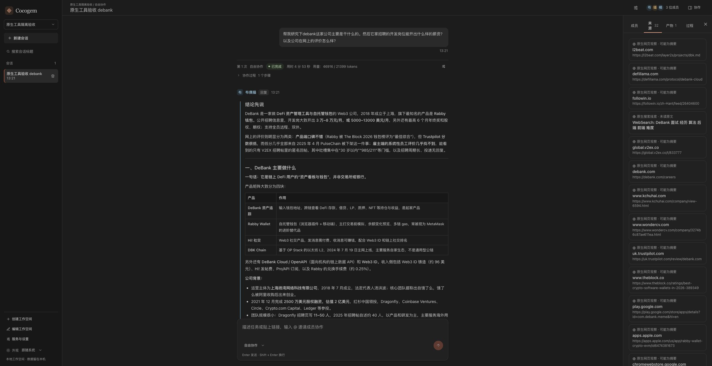

# 原生工具优先实施与独立验收

日期：2026-10-28。由本机 Claude Code 实现，Codex 独立审查、提供失败反例并验证；本轮改动已合回当前工作区，未 commit/push/发布。现有未提交修改与并行 UI 工作保留。脱敏运行记录见 [验收摘要](evidence/native-tools-20261028.json)。

## 产品决定

Cocogem 是本地多 Agent 协作工作空间。CLI 负责模型调用与通用工具循环，Go 负责成员、授权、协作调度、上下文、来源与产物。复用 CLI 已有 provider/key/endpoint/model，不要求重新登录。平台 MCP 保留任务交接、共享技能、上下文与来源分页、产物发布。

参考固定版本 [Clowder b2c9952](https://github.com/zts212653/clowder-ai/tree/b2c9952f27d31480191ff6fd120789405c97238c) 与 [Multica 8ffcc88](https://github.com/multica-ai/multica/tree/8ffcc88dbdf13d8b1c7f6c9779920d0bb04ea663)：两者正常执行保留原生工具，再组合平台 MCP；Clowder 仅在明确 read_only 分支清空工具，Multica 关闭后台无法呈现的 AskUserQuestion，并按 Agent 分配 MCP。这支持复用通用能力与补充协作能力的分工。Cocogem 按自身研究/只读分析范围启用子集，未照搬 bypassPermissions，也未增加任意 shell 或写入权限。

本轮不增加累计时长或工具次数硬停健康任务，不新增原生模式、授权复选框或 consent gate。

## 最终行为与取舍

| 能力 | 当前行为 | 好处与代价 |
| --- | --- | --- |
| Claude 文件 | 现有有效授权派生 Read/Glob/Grep；工作区根为 cwd，敏感路径拒绝，关闭项目指令自动加载 | 复用原生工具；依赖 CLI 权限实现，真实安装版检查是必要证据 |
| Claude 联网 | auto/web_discovery 派生 WebSearch/WebFetch；继承既有网页代理；given_sources 保持受控 MCP 访问 | 可使用原生检索/抓取；联网由 CLI/provider 网络策略负责，Go transport 的 SSRF 检查不覆盖该路径 |
| Codex 联网 | 两项联网授权同时存在才开合并 web 工具；只有实际返回内容才保存线索 | 保留原生能力；当前真实 case 返回为空，需 MCP 后备，不能声称原生来源保存已通过 |
| Gemini | 继续 MCP | 安装版事件不暴露真实结果正文，避免把展示状态当证据；原生联网暂未启用 |
| 原生来源 | native_file / native_web / native_search，服务端分配 ID，list_sources 取 ID，read_source 分页 | 保留可追溯记录；增加一次元数据获取，WebFetch 只保证 CLI 返回的观察/摘要 |
| 原生优先 | 系统提示列出实际工具名与映射，对应 MCP 描述明确为失败/无可用内容后的 fallback | 最小实现且可恢复；属于模型指引，模型仍可忽略，不是执行强制边界 |

成员权限仍是 global allowance 与 workspace grant 的交集；撤权、停用、解绑会停止受影响的当前运行，改名不停止。运行期私有配置统一位于受原生与 MCP 路径规则保护的 `.cocogem` 子目录。

原生文件保存 CLI 实际返回正文与行范围，缺少完整性信息则标不完整；宿主不重新读文件补证据。原生观察最多 512 KiB，超限明确截断；UI 事件正文另受限，file.content 不夹带进事件元数据。native_search 仅作线索，不能单独支撑 supported/confirmed；引用 native_web 的产物自动附加摘要限制。

### 未开放工具的窄范围拒绝恢复（2026-10-29）

`--tools` 仍是 CLI 强制边界，解析器只是协议守卫。已安装 Claude 2.1.312 的本地假模型实验显示：模型可请求库存外工具，CLI 的 `init` 库存仍只含允许工具，并在同一 call ID 返回固定的 `No such tool available: <name>`（Bash/Task 另有固定 `is disabled for this session...` 后缀），没有执行副作用。解析器因此只接受这种精确证明：记录有界拒绝事件，不保存/输出参数、不发 `tool_started`、不重启或重放 CLI；成功结果、其他错误文本、身份冲突、缺失/重复 call ID、pending 无结果、多暴露库存和超过三次拒绝仍 fail closed。Codex/Gemini 没有等价证据，不扩恢复面。详见 [协作循环验收](collaboration-loop-acceptance.md)。

## 真实验收

全部使用隔离测试库与本机既有 CLI 配置，真实用户数据库未写入。单次执行时间是本次观察值，不是性能承诺。

| 场景 | 实际结果 |
| --- | --- |
| 双成员静态文件分析与独立复核 | succeeded，120.44 秒；4 次原生 Read、1 次 Glob、6 次 Grep；1100 行合成资料末尾的反证、两组价格、单位、撤销日期保留；2 份产物引用有效，未用宿主 read_file 重读 |
| Codex 搜索/打开官方文档 | succeeded，116.46 秒；2 次原生调用完成但未返回可保存内容；未制造来源，MCP 后备抓取文档并发布 1 份纪要，明确证据缺口 |
| DeBank 原问题原文 | succeeded，293.16 秒；约 3.59 秒出现首个工具活动，18 次 WebSearch + 31 次 WebFetch，49 条实际原生观察，1 份纪要；产物引用的 20 个 native_web 来源全部存在，搜索线索未单独支撑有依据结论 |

原问题未附加任何“优先原生”提示。修正前同一原问题虽完成，但零原生调用，暴露了旧系统提示与 MCP 描述冲突；将实际能力和后备用途写清后复验转为先原生。一次成功不保证所有模型、站点或所有后续运行都会如此选择。

真实 Chrome 检查了运行中与完成状态、原生工具活动、文件/网页观察/搜索线索标签、来源正文、产物结构和自动附加的摘要说明；原生结果不再显示 undefined ms。页面截图如下（隔离测试、公开研究问题）：

## 审查与检查

独立反例覆盖配置路径别名、MCP 后备读私有配置、撤权后断开 HTTP 连接、结果元数据夹带正文、空白网页、摘要披露绕过、长 UTF-8 元数据分页、旧搜索页强度及 Codex 未完成工具调用。对应修复及回归已进入源码，9 条独立 overlay 测试通过。

合回主工作区后：

- `GOFLAGS=-p=1 make test` 通过：gofmt、vet、race/shuffle、终端 CLI integration、前端 lint/typecheck 与 **122** 项测试。
- `PLAYWRIGHT_CHANNEL=chrome GOFLAGS=-p=1 make e2e` 通过：生产构建、开发进程管理、HTTP/backup/restore smoke、Chrome **7/7**。
- 安装版 Claude 原生文件边界检查通过：公共文件可读；`.env`、`.git/config`、根外与根外软链接拒绝；项目与父目录指令未自动加载。它使用本地假模型，只证明实际 CLI 的协议/权限，不冒充供应商验证。
- `make probe-cli`、`make probe-isolation` 在合回后的主工作区通过，覆盖三端真实安装版与本地假端点；不替代真实供应商验收。
- `make contract` 再生成前后 API/OpenAPI 与前端 schema 哈希相同；密钥扫描通过。

隔离副本中的 Chrome 3 项失败，已在本轮实施前快照同样复现；主工作区包含并行 UI 修正，合回保持其修改，最终 7 项全部通过。这些 UI 修正不计为本轮原生工具实现。

## 限制

原生联网不能消除真实 HTTP 403、站点验证、无正文或 CLI domain safe-check 问题；实际错误保持可见。Codex 原生来源保存与 Gemini 原生联网仍有上述能力缺口。本轮两个隔离服务及新开的浏览器标签已关闭，原有服务、真实用户库和现有 CLI 凭据未改。未做 Linux 验证、完整研究事实审计、commit/push 或部署。DeBank 纪要的历史招聘区间不构成当前薪资报价，具体日期、评分、商业断言仍需针对事实复核。
