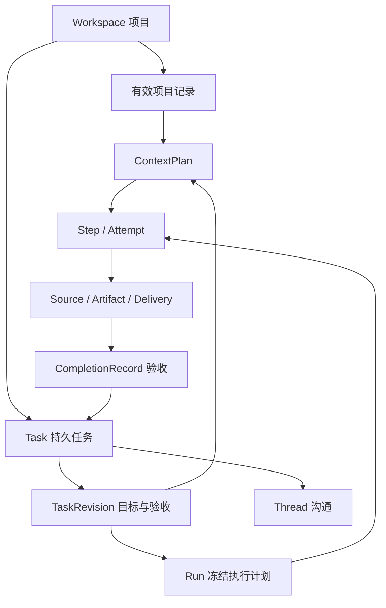

# Cocogem 项目协作内核重构设计

状态：**M1–M4 的纵向实现已落地，并通过 Go 竞态/单元/集成、契约、前端和浏览器合成旅程验证；显式工作方式/开发动作选择仍按当前 product 契约运行。真实供应商任务、adapter×OS 隔离、真实语料定位与长期项目评测仍按第 16.2、17 节关闭**

日期：2026-11-03

更新：2026-11-04，合并已确认的任务间 A2A、主动评审、信息披露与摘要核对、持续授权、三种权限模式及可配置协作预算。

目标：以极简、开箱即用的体验，可靠推进复杂工程、复杂研究和长期项目。

基线：Cocogem `b7bb1fa749ecf855ea6cd1e044ad9c8242c8bf4e`；Clowder 参考版本 `42017e0cea07e3e259e7fb183be70433f05e131c`。

本文是目标架构 RFC。当前行为仍以 [product.md](product.md) 和已实现代码为准；[context-engineering.md](context-engineering.md) 保留为原始上下文提案。本文对它的修订见第 7 节。实现每一阶段时再同步产品定义、AGENTS、HTTP 契约和行为测试，不提前把设计写成已上线功能。

2026-11-08 增量：本轮权限、预算入口、成员工具配置和任务页面以[全局权限与界面合同](2026-11-08-permissions-and-ui-redesign.md)为准，实际完成证据见[验收记录](2026-11-08-permissions-and-ui-acceptance.md)。本文相关核心规则已按增量更新；原 M0–M5 分期保留为架构背景，不代表全部 CLI/OS、长期评测或未来集成部署均已验证。

**实现者入口：** 本文是此次重构的目标行为依据，原上下文提案中与本文不一致的设计不再实施；讨论记录用于解释取舍，不覆盖主稿。先读第 1.1 节不变式、第 15 节交付顺序和第 16 节验收，再按阶段实现。当前 AGENTS/product 中“必须显式选择开发”“每步 fresh”“只准固定测试命令”等旧行为，在对应阶段与实现及回归测试同批更新；它们不构成对已经确认的目标方案再次索要设计批准的理由。仍保留成员 ID、不可变历史和旧 Run 恢复兼容契约。

阅读路径：产品与视觉见第 3 节；领域模型见第 4 节；上下文与记忆见第 5–7 节；权限与 CLI 见第 8 节；编排见第 9 节；工程/研究见第 10–12 节；实现与迁移见第 13–16 节。设计讨论、取舍与评审结论见 [讨论记录](design-reviews/2026-11-03-redesign-discussion.md)。

## 1. 设计结论

Cocogem 的核心从“一次对话组织几位成员交付报告”扩展为“围绕项目目标持续执行、验证和积累成果”。用户仍通过对话表达意图；平台保存当前有效的目标、任务、权限与证据，使工作可以换成员、换会话、换模型、跨天和跨重启继续。

职责分工如下：

- **用户**决定目标、重要取舍和授权范围；已经表达的意图不反复索要确认。
- **Agent / 原生 CLI**负责理解、探索、调用工具、提出计划、实现、研究和审查；可以在明确边界内连续自主工作，并直接向同伴提问、交接和核对证据。
- **Cocogem**负责持久任务、权限上限、输入版本、执行隔离、调度恢复、证据归属和可核验的完成状态。
- **外部系统**提供 Git、CI、网页、数据集、部署环境等真实事实；平台记录实际观察，不根据模型文字推断成功。

保留 Go 标准库 HTTP、SQLite、显式构造注入、现有 Run/Step/Attempt、scoped MCP、来源和不可变交付。逐步替换上下文拼接、固定流程入口和过窄的工程执行面，不从零重写可靠执行底座，也不照搬 Clowder 的所有子系统。

### 1.1 必须成立的不变式

1. **目标能改变，历史不能被改写。** 新要求形成新版本；旧交付继续代表当时的事实。
2. **执行完成、目标验收、代码合并、环境生效分别记录。** 一个状态不能代替其他状态。
3. **宿主可读取范围先于检索与上下文选择。** 宿主注入、MCP、A2A 投递和 session 自动恢复遵守数据边界；完全访问下任意本机命令的旁路限制按第 8 节如实声明，不能承诺所有本机读取都受此范围控制。
4. **原生 session 是可丢弃的执行缓存。** 项目能否继续，不取决于某个 CLI 的私有聊天是否还在。
5. **权限按当前授权收紧。** 旧 Run 快照不能复活已撤销能力；普通重试不扩大授权。
6. **外部副作用结果不确定时先核实。** 不以重新调用来猜测上次是否成功。
7. **自由度与实际能力相符。** worktree 不是安全沙箱；提示词不是 OS 权限；看不到的操作不能声称已经完整审计。
8. **用户不需要管理内部机制。** 模型窗口、摘要层、步骤图、租约、session、工具协议默认由平台处理。

### 1.2 非目标

本轮不建设多人企业租户、分布式执行集群、任意插件市场、通用流程 DSL、自动生成的组织层级、全局个人画像或无限自治。先把本地单用户的真实工程和研究闭环做好。跨项目资料共享显式导入，默认不自动串联全部个人数据。

## 2. 现状、缺口与参考边界

| 当前基础 | 长期项目中的缺口 | 本次演进 |
| --- | --- | --- |
| Workspace / Thread / Run / Step / Attempt | 任务通常等同一次提交，缺少跨 Run 的目标与验收 | Workspace 作为项目，增加持久 Task 及目标版本 |
| 检查点、重试、进程归属核验 | 能恢复执行，不能完整解释需求与工程基线变化 | 恢复前核对任务版本、依赖、权限、副作用与代码基线 |
| 最近历史、精确引用、分页 | 旧约束丢失，跨会话承接弱 | 项目有效状态、工作记录、授权检索、ContextPlan |
| 不可变产物与来源 | 报告交付不等于需求完成 | 验收记录绑定条件、交付版本和证据 |
| scoped MCP 与严格工具交集 | 原生 CLI 工具生态、持续 session 和工程命令受限 | 能力驱动的原生执行，保留受控回退与明确完全访问 |
| 同会话串行、会话间并行 | 不同会话可能修改同一目录 | 工作项独立执行目录、共享目录租约与集成队列 |
| 固定工程/研究流程 | 一轮流程结束后缺口仍在报告里 | 有界任务推进，遗留项成为持久工作 |
| Run 内有界成员委派 | 已独立推进的任务不能持续互问、回传和纠正假设 | 任务间持久 A2A，区分通信、委派和责任转移 |
| 运行时禁止发送 | 不能及时纠偏 | 持久 inbox、明确生效边界与停止语义 |

Clowder 值得借鉴的是持久任务与责任版本、worktree 生命周期、知识来源、队列恢复、评审覆盖版本和部署状态区分。其部分 SOP 是 Agent 执行的 checklist，部分是程序门禁，不能混为一谈。仓库中的自用合并脚本也不能直接推导为外部项目的通用托管能力。

本方案采用“风险决定验证强度”：局部可逆改动快速完成；持久化、权限、契约、并发执行及高影响研究结论使用更强证据。跨模型数量和流程步数不是质量指标。

## 3. 产品与交互：两个主页面

用户只需要理解**项目、任务、成果**。Workspace、Thread、Run 等保留为内部/API 概念，默认 UI 不逐一暴露。

### 3.1 首次使用

1. 设置 Web 本地密码，保留现有解锁方式。
2. 检测可用 CLI，复用既有 provider、endpoint、模型与凭据。一个可用 CLI 时自动建立可编辑的默认成员；多个时给默认协调者，成员配置不是必填向导。
3. 直接输入目标。研究无需工程目录；第一次工程任务就地选择目录。
4. 在同一页面看到实际进度和成果。连接问题展示真实诊断，不以“重新登录”替代配置转发排查。

自动建成员只创建档案及关系。成员身份、档案与历史授权原样保留；新执行按全局权限、任务/角色和会话操作授权准入。

成员不再维护全局或空间工具允许集，统一采用标准运行时能力目录；旧工具数组作为历史兼容，不形成新执行的隐藏限制。独立审核与语义只读约束继续生效：审核可读取、协作、报告及在独立验证副本中测试，不允许修改作者候选或借授权扩大职责。测试写自己的临时区不等于获得作者写权限。

缺少可申请的操作范围时，在执行前显示确切工具、动作、目标和摘要，提供仅本次、同会话持续或拒绝。持续授权由同 Thread 合格成员共享，仍限于原工具/动作/资源；不再要求编辑成员工具或重复到空间设置补权。

首次输入按需创建默认“未命名项目”和成员关系，用户不必先填表单。首次初始化与旧模型一次性迁移默认全局“项目内自主”，之后新空间沿用当前值；Composer 与“设置 → 权限”同步。范围内按实际能力自主执行，项目外操作先申请确切范围。能力探测不自动切为完全访问，未验证执行边界明确报告，不把受控回退算作原生自主能力已交付。无可用 CLI 时保留草稿并显示真实连接诊断。

### 3.2 短问与长期工作

- 简单解释、一次检索或局部问答直接回答，不展示计划审批。
- 明确开发、多个交付、依赖关系、跨天继续或持续跟踪时，在原对话建立 Task；必要时拆分子任务。
- “分析这个仓库”保持只读；“实现这个功能并测试”表达开发意图，但仍受项目已有权限约束。第一次超出权限时才呈现具体授权卡。
- 用户可显式指定原有讨论、Research、分析、开发模板；显式选择和已接受计划优先于自动判断。
- 自动整理可编辑、可撤销；目标、范围或重要验收不由模型悄悄改写。内部任务拆分无需逐项批准。

建议 UI 不再强制用户先选择工作流。输入区提供轻量“分析 / 开发”覆盖项，默认为已识别意图；自然语言和显式控件冲突时以更明确、更受限的选择为准并提示。该行为属于未来产品变更，实施时须更新当前“显式选择开发”的产品/AGENTS 契约。

覆盖项仅在工程意图出现时放在输入区菜单，常态不增加第二排控件。混合目标“先研究选型，再实现验证”形成同一父 Task 的不同能力子任务，读取、研究计算和工程修改按已有授权分别核对；可由一次项目/任务授权一起覆盖，不拆成多次确认。工程协作是单一流程，成员按已获授权的能力读取、修改或测试；完全访问下用户明确“只分析”仍保持只读目标。研究计算超出已有范围时才使用“运行分析”能力卡，不要求研究者切换到开发模式。

### 3.2.1 任务入口与会话升级补充（2026-11-07）

经本次任务工作区改造接受的交互：任务可先保存、执行时派生会话；会话也可在目标明确后原地升级为任务。简单解释、一次检索、假设讨论与否定执行保持轻量问答。意图识别复用首轮模型，通过受控 `promote_to_task` 请求升级；宿主核对当前用户消息、授权与去重，绑定持久状态后再开始任务执行步骤，不增加独立分类模型调用。工作流选择和任务身份分别处理，旧已接受计划与原有权限交集保留。

首页图标始终承载首页和全部会话，任务图标承载全局看板/列表与详情。状态展示区分运行成功的待验收与真正已验收。普通问答历史不回填 Task；任务验收支持确切产物与属于该任务的成功最终回复。当前实现、自动化与真实供应商验证范围见 product.md，不由此补充推导其他迁移阶段或平台能力已验证。

### 3.2.2 明确指派与输入提示补充（2026-11-07）

用户在本轮正文中明确指定的成员与分工优先于已选 workflow 和默认角色，无需先调整输入区流程。没有新指派时仍按 workflow 执行；覆盖仅作用于当前提交，不回写会话默认流程或历史计划、不扩大权限。内置流程仍有空缺角色时，协调者按运行时名册的职责、能力、实际工具权限和当前任务选择成员；全局默认分工优先，宿主校验角色互斥与工具权限，失败时才按会话顺序回退，协调者只在没有其他可用成员时补执行角色。会话错误与路由澄清在输入框上方显示浮层，右上角以圆形关闭控件收起，保留草稿并恢复输入焦点。选择附件只保留本地草稿，首次发送时才创建会话并上传原件。此补充的代码、API 行为测试及桌面/移动浏览器合成旅程已验证，不代表真实模型语义质量或其他平台验证。

### 3.2.3 成员重试补充（2026-11-07）

回复失败时，在该成员回复旁及输入框上方提供确切成员步骤的重试；输入框提示每轮失败只出现一次且不持久记录弹出状态。补跑结果在原用户轮次内原位替换未完成的旧回复，不新增重复消息。新执行保存来源，复用已完成成员的消息/产物引用及已核实候选目录，只补跑失败步骤与原计划尚未执行的后续工作；多个独立失败成员可以分别补跑。请求去重跨越执行终态，不改写原 Run 的步骤/尝试或重置根预算。提示可关闭并保留草稿，部分补跑交付不代表整个 Task 已验收。API/浏览器使用故障注入验证，真实 Gemini 调用另用合成只读文档验证，范围见 product.md。

### 3.3 项目概览

```text
订单系统                                      新任务
目标：兼容已有客户端，为订单创建提供幂等保证

需要你处理
  测试环境尚缺数据库地址                     查看

正在推进
  幂等请求支持     正在补充并发测试            打开
  迁移评估         等待接口方案确定            打开

最近成果
  接口方案 v2      当前有效                    阅读
  实现候选 v3      还缺集成测试                查看变更

全部任务 · 项目资料
```

“需要你处理”为空时不占版面。默认不展示依赖图、健康分、成员排行榜、token 图表或伪造进度百分比。返回项目时可展示由事件和验收记录生成的变化摘要，点击可追溯。

### 3.4 工作对话与详情

主区展示用户输入、必要进度和最终成果；多成员交接、工具调用、模型参数收进一个“执行过程”。实质分歧、阻断发现和验证缺口出现在成果附近。

任务卡只显示目标、当前动作、下一步和验收概况。“查看计划 / 变更 / 来源 / 验证”打开有稳定 URL 的详情面板；同一时间只打开一个详情面板。高级上下文检查器属于执行详情，不成为独立后台。

保留 Enter 发送、Shift+Enter 换行、IME 确认、`@` 补全与自然语言选人。助手正文 `@` 不触发派发。不新增自动指派控制、数据共享复选框或逐轮同意门禁。

Coder 可按已接受的验收政策主动调用工具请 reviewer 审查。工具收到持久回执后，UI 展示“Coder → @Reviewer · 等待审查”，后续状态来自真实投递/执行记录；普通文本“之后可以请 @Reviewer 看看”或引用示例不派发。Reviewer 可直接向 coder 追问条件、证据或修复，过程默认折叠，实质分歧在结果附近显示，不要求用户转述。

### 3.5 执行中输入与问题卡

运行时允许发送，默认“保存补充，在下一个执行边界应用”。状态必须从持久记录读取：`已收到 → 待应用 → 已应用到目标 v3`。发送菜单可选“立即打断”或“加入后续任务”，默认只显示发送按钮。

目标改变时暂停受影响计划并创建新版，不修改运行中的输入快照。停止按钮先显示“停止中”，进程与副作用核实后才显示“已停止”。其他独立任务继续工作。

需要用户介入的情况限定为：缺少决定结果的必要信息、当前授权不足、结果不确定且无法自动核实、协作预算需要调整或任务明确要求人工验收。资料不够优先查原文、询问同伴；合理可逆的实现假设说明后继续。卡片写清具体选择与影响，复用既有授权；同一问题跨成员合并成一项，不让 A2A 变成用户审批队列。

### 3.6 视觉规则

- 保留现有浅色、深色、暖色和系统主题，复用 CSS tokens；中性色为主，单一强调色。
- 桌面：窄项目导航 + 主内容 + 按需详情；不固定堆叠成员、日志、上下文、来源四列。
- 正文建议 15–16px、行高约 1.6，技术元数据次要；8px 间距基准、有限圆角与阴影，状态不用连续动画。
- 主内容保持适宜阅读宽度；diff/表格可扩展。正常运行不以大面积绿色或多层胶囊强调。
- 移动端单列，详情全屏；返回保留草稿、滚动与选中任务；主要触控目标至少 44px。
- 键盘可到达所有操作，焦点可见，状态不能只用颜色表达，支持 reduced motion 与读屏通知。

## 4. 领域模型：项目持续，执行有界



### 4.1 核心对象与最小字段

| 对象 | 职责与关键字段 |
| --- | --- |
| Workspace | 项目边界；目录/资料集、成员、默认执行配置、当前 project revision |
| ProjectRecord | 有效目标/约束/决策/规范；稳定 ID、不可变版本、状态、适用范围、来源、替代关系 |
| Task | 长期工作身份；workspace、parent、主要 thread、当前 revision、owner/member、owner_revision、root_control_epoch、状态、优先级 |
| TaskRevision | 目标、scope/non-goals、约束 refs、验收条目、输入 refs、允许动作、预算、来源与接受依据 |
| TaskDependency | 生产者与消费者、确切 completion/artifact ref、pinned/track-current、时效策略、有效性 |
| CollaborationMessage / DeliveryReceipt | 任务间不可变消息信封、因果/回复、资料范围与逐接收方投递记录；不替代 Task owner/完成记录 |
| Run / Step / Attempt | 保留现有执行对象；新增 task revision、输入快照、grant/session/context refs |
| WorkspaceExecution | 独立执行目录；Git worktree/文件副本、基线、归属、写入租约与回收状态 |
| CompletionRecord | 针对任务版本的逐项验收、证据、判断者、未决项与候选交付 |
| EffectRecord | 受管理副作用的意图、幂等键、授权、前后状态、远端标识、结果/不确定态 |
| Grant / ExecutionSession | 权限范围与撤销版本；原生 session 的身份、角色、能力与恢复条件 |

这些是逻辑对象，不要求第一阶段一次建齐所有表。ChangeSet、ReviewResult、ClaimSet、DatasetManifest 先作为有版本 schema 的 Artifact 类型；共享一个来源、交付和查询机制，不为工程与研究各造一套调度系统。

`ProjectState` 是当前有效 ProjectRecord 的确定性投影，`WorkRecord` 是 Task/Run/Effect/Completion 的恢复视图；两者不是额外可独立编辑的真相源。TaskRevision 保存初始预算政策引用，实际累计与后续预算调整由稳定根预算账户拥有，不能出现两份相互覆盖的余额。

### 4.2 TaskRevision 与计划

任务版本回答“要实现什么”，执行计划回答“准备怎么做”。内部步骤重排只形成新的 PlanRevision，不能借重排删除验收或扩大范围。Run 冻结目标、成员名册、授权上限、输入快照、策略版本与预算；已接受的内置计划不变。

自由协作继续允许现有 `handoff_task` 在同 Run 内追加有界步骤与 continuation。每次扩展是事务性 PlanDelta，记录父计划版本、来源与预算，校验依赖后追加，不能回写已经执行步骤的输入。改变目标、扩大名册/授权或替换已接受内置流程才在边界创建新 Run；“冻结契约”不等于禁止合法动态交接。

用户明确输入可直接成为接受依据，不再弹“确认你刚才说的话”。模型抽取不确定时保留为 proposal。模型可自动接受授权内的可逆任务拆分；范围缩减、重要取舍、权限扩大和对外承诺必须有用户来源。

验收条目有稳定 `criterion_id`，并记录 `statement / required / kind / evidence_requirements / evaluation_policy / applicable_when`。禁止用“写了代码、成员一致、完成若干步骤”代替用户结果。

### 4.3 状态与并发

```text
draft → ready → active → completed
          ↑       ├──→ ready（还有明确后续工作）
          └──── waiting（input/dependency/external/budget/environment/uncertain_effect）

未完成状态 → paused → ready
未完成状态 → canceled
completed + 接受新目标版本 → ready（旧完成记录不变）
```

Task 的失败恢复通常通过 waiting/ready 表达；Run/Attempt 记录具体失败。暂停和取消阻止未来唤醒。父任务必须满足自身验收，子任务全完成不自动代表集成完成。

为长等待增加仅用于新 Task 执行段的 Run 终态 `yielded`：同事务保存 continuation/checkpoint、等待条件与已知 effect 状态后结束本段，释放 Task/Thread 活跃唯一约束。它不是 succeeded，不要求伪造最终 Delivery；已有中间观察保留。唤醒创建新 Run，关联 `continued_from_run_id` 并计入自动续办额度。旧 Run 的 interrupted/resume/retry 语义保留；Run 内短期 Step 依赖仍用原调度，不为每个工具等待创建新 Run。新增终态必须同步数据库约束、终态查询、清理、API/SSE 和前端状态合并。

根任务的 owned descendants（由其自动创建并共享预算）继承 root control epoch。暂停/取消原子阻止该树的新准入，在途执行按停止/核实协议收敛；父任务等待子任务不等于暂停子任务。仅引用或订阅的既有任务不随根任务取消，只撤销本方订阅。明确独立发起的新用户任务有自己的根账户；模型不能借重建根任务逃避取消/预算。

当前验收投影独立保存 `current / needs_revalidation / incomplete` 与 `evaluation_generation`。同一目标版本下，上游变化或时效到期也能使 completed 转为 ready/waiting（若已授权复验），无需伪造新的用户要求。暂停/取消任务只更新投影，不自动唤醒。提交验收同时核对 task revision、input snapshot digest 和 evaluation generation，旧执行不能把已失效的结果重新标为当前通过。

第一版同 Task、同 Thread 各最多一个活跃 Run；独立 Task 可并行，Task 内并行复用 Step DAG。独立写任务必须有不同执行目录；共享目录使用 canonical root 级租约，冲突检查覆盖父子路径重叠和真实目录别名。多个服务进程通过 SQLite claim/lease 原子竞争，不能只靠进程内 map。

并行子 Task 使用各自的内部执行 Thread，默认不进入侧栏；Run 和消息仍属于确定 Thread，保留现有按轮次处理历史的语义。根对话呈现折叠进度/确切成果引用，不把子运行消息交错写进同一历史流。子 Thread 可从任务详情打开稳定链接。根 inbox 修订通过依赖与 evaluation generation 影响子任务，不能把一句补充无差别广播给所有成员或默默覆盖各自目标。

写租约 TTL 到期只说明 owner 失联，不能证明旧进程停止。接管同一目录前必须核实旧进程/沙箱已退出；否则 quarantine 原执行目录并等待核实，或在新的隔离目录工作。数据库 epoch 能拒绝旧结果提交，但不能单独阻止旧 shell 继续写磁盘。

### 4.4 依赖与失效

- `pinned` 使用确切版本，适合历史研究、固定接口契约与可复现实验；上游后来更新不改写当时结果。
- `track_current` 跟踪当前接受结果，适合后续实现和当前状态建议；相关输入变更标记消费者待复验。
- 时效条件独立，例如“截至某日期”“当前主分支”“30 天内复核”。来源捕获时间不等于内容发布时间或有效期。

保存实际消费的版本与对应验收条目。无法证明变化无关时保守标记需复验，先做影响判断再决定重跑范围；禁止无界级联自动重跑。循环依赖拒绝入库。历史 completed 保留，UI 显示“旧版本已验收；当前版本待复验”。

## 5. 上下文：选择可信状态，按需展开资料

### 5.1 三种范围必须分开

1. `EligibleScope`：宿主允许本次执行读取的对象集合、版本/可见性规则与授权 epoch。
2. `ContextPlan`：从 EligibleScope 中选择的启动输入及后续读取入口。
3. `ReadReceipt`：执行中实际通过宿主或可核验原生事件读取了哪些片段。

检索不能扩大 scope。Scope 可覆盖当前任务可见的项目发布记录和历史资料，不再等同最近消息窗口；通过冻结 collection revision / cutoff 与精确对象 digest 表达，避免把全库 ID 塞进提示。

执行中合法新捕获资料走受管理的 scope append 事件；不能声称全部 scope 永不变化，也不能让模型凭任意 ID 增权。权限撤销实时生效；新发布项目资料在下一执行边界进入。

**控制职责：** 用户决定项目/任务及明确私密边界；平台根据对象归属、已接受授权、当前角色和阶段生成 scope，执行确定性访问检查。协调者只提议分工与相关资料，不能自行授予访问权限，也不能把“摘要暂时没选中”改成“接手者无权看原文”。成员可检索、分页读取和发起 A2A 追问；这些动作在既有范围内自动执行。

**默认披露政策：** 新任务在接受时建立 `collaboration_scope_id`（根任务及其明确依赖关系）；同一授权任务链内的相关已提交工作、依据和有效约束按该政策可读，不逐条请用户授权。全项目有效规范/决定是 project-visible；无关线程原文不自动开放。独立观点/评审草稿、用户标记的私密资料、凭据另有限制。成员被授予任务后自动获得完成职责所需的允许范围，范围仍受更窄的资料标签约束。跨项目/脱离任务链共享需要已有导入授权或新的具体范围决定。

独立评审冻结候选和有效需求，初始不提供作者自评与其他 reviewer 的判断；已知缺陷、失败测试、反证和重大限制必须可见。初次独立判断提交后可进入问答阶段，记录新增输入；若发现缺少必要事实，应先补事实再提交判断，不能为维持“盲审”故意隐瞒风险。事后污染了输入的 session 不能倒称为原先的独立判断。

### 5.2 ContextPlan 输入层

| 层 | 内容 | 处理原则 |
| --- | --- | --- |
| 固定政策 | 当前执行能力、任务身份、角色边界 | 由宿主生成，模型内容不能覆盖 |
| 当前有效状态 | TaskRevision、active 约束、验收、必要的项目决定 | 必需信息完整呈现；不以首条消息代替 |
| 工作记录 | 已完成/待完成、当前基线、失败尝试、未决副作用、下一步 | 来自持久事实，模型小结只补充解释 |
| 精确依赖 | 上游产物/研究证据/代码与测试版本 | 必要字段 inline，长文 excerpt/ref |
| 最近对话 | 本任务近期用户补充、必要成员对话 | 保留语义轮次；有界头尾与定位 |
| 摘要与检索 | 授权旧资料、章节摘要、相关知识 | 可淘汰，标为派生/检索结果 |
| 按需正文 | 完整原文、数据、日志、大报告 | 工具分页；返回原文定位和读取回执 |

P0 是有效要求，不是永久 pin 的旧原文。Pin 表达重要性，不改变权限、真实性、当前有效性或证据等级。被替代的 pin 保留历史标记，不能继续作为 active 约束。

### 5.3 预算契约

保留 `context_size` 的宿主输入预算语义；0 使用平台默认策略，不表示窗口无限。分别保存：宿主输入预算、声明模型窗口、窗口来源/可信度、输出预留、原生开销与工具循环余量。

```text
host_input <= host_input_budget
host_input + native_overhead_estimate + tool_growth_reserve + output_reserve
    <= known_model_window - safety_margin   // 窗口可靠已知时
```

宿主预算包含可计量的系统内容、工具 schema、消息及序列化开销。模型窗口未知时使用保守预算，标明未知；不伪装精确 tokenizer。每项定义 `inline / excerpt / ref` 和最低必需字段；最低必需集合放不下才阻塞。

原生 CLI 内部多轮不能完全由启动检查保证：限制每次工具结果，长结果外置，按预算/有效进展创建工作记录并切段。仅有总 usage 时不能当作每次真实输入窗口。实际 token、缓存和费用按供应商报告质量标注，unknown 不写成 0。

### 5.4 摘要、检索与防污染

- 先确定性生成任务/项目 brief，再做按完成轮次分块的模型摘要。摘要有来源 refs、digest、生成模型/策略版本与适用范围。
- 摘要覆盖来源级去重；不同成员预算下允许选择不同块，不要求一份摘要恰好适配全部 recent window。
- 摘要只有所有源材料均对角色可见时才可用；否则从可见来源重新生成。不能先汇总独立观点，再隐藏原文假装保持独立。
- 初期 SQLite FTS5；中文检索评测包含短词、混合代码标识和 trigram 限制，受限 LIKE 只是明确降级。召回先过滤权限/有效性，再按相关性、时间与任务需求排序，不机械优先新消息。
- 显式引用、有效约束不依赖搜索命中；自动检索缺失不能淘汰必需要求。
- 网页、仓库文字、工具输出是数据，不能授予权限、发起交接或修改治理规则。模型提出动作仍经宿主契约校验。
- 失败 Run 中已提交的复现、负面测试和有效观察可用，带状态和版本。未完成草稿、错误响应、已验证事实、正式交付分别表示。

**谁写摘要：** 项目目标、当前有效约束、任务状态和验收结果由平台从权威记录确定性组装；任务负责人生成阶段工作摘要，协调者汇总跨任务结果；旧对话压缩由受同一 scope/预算约束的后台摘要调用生成。摘要调用固定 policy/模型/来源版本，费用归所服务的根任务。它不因此成为权限管理员或真相源。

**交接摘要的最低契约：** `task_revision / claim_or_result / applicability / supporting_refs / contradicting_refs / limitations / unresolved / omitted_topics / source_versions / author_member_id`。字段可为空，但不能把未知伪装成已检查为空。重要条件、反证和会推翻结论的限制属于最低必需信息，不因预算优先丢弃；放不下则缩小交接范围或给出明确缺口。平台检查字段、引用与版本，独立审查判断语义是否充分，不能声称结构校验杜绝遗漏。

接收者对关键判断应展开任务要求的原文/代码/数据，而不是引用摘要代替核对；读取回执只证明提供了材料，不证明理解正确。存在疑问可按第 9.6 节直接找原负责人，附结论、版本和具体问题。负责人离线或原生 session 已结束时，可从允许的工作记录唤醒一次答疑；不存在可核对记录时返回依据缺口，不编造旧推理。

摘要采用不可变版本，纠正后沿其消费引用标记相关结论待复验，旧摘要保留。新资料/摘要补充与正式目标变更分开：同伴解释本身不能修改用户要求，也不能替代新实测证据。

引用存在不代表正文足够完整。摘要/交接记录各关键来源的 `complete / partial / unavailable` 与确切定位；缺原文时先读取相邻片段，仍不足且授权允许则重新获取并创建新 Source 版本。解析失败、已删除或无权读取时记录其影响的 claim/criterion，继续不依赖它的工作。无法补齐的关键依据不能据此标 supported/passed；同伴回答也须附证据或承认缺口。只有确实影响结果且资料、同伴均无法解决时才询问用户，不自动扩大 scope 或泄露被拒绝资料细节。

### 5.5 Manifest 的准确承诺

记录宿主发送了什么和能证明读取了什么：有序 refs、精确版本/digest、字节或段落区间、表示形式、入选/排除原因、策略/模板版本、估算与报告 usage。原文只存一份，manifest 引用内容寻址对象。

Attempt、预备 manifest 与本次纳入的 inbox ID 同事务写入；实际启动和输入接收再记录 submitted/acknowledged/unknown。数据库提交不是 CLI 已收到输入，断线时不承诺“恰好呈现一次”。恢复可再次呈现同一 message ID 并标注重送，逻辑修订和外部副作用仍只应用一次。Run 冻结 context policy，旧 Run 恢复不悄悄切换新策略。

UI 分“启动输入”“执行中读取”“CLI 未报告部分”；不声称知道模型注意了什么。权限拒绝的资料不能在排除原因里泄露标题或正文。

分离三种摘要值：输入渲染 digest、授权/来源快照 digest、已完成工作 digest。换摘要措辞或排序不算工作进展，不能绕过当前防止无进展溢出重放的保护。

## 6. 记忆：可追溯知识与当前有效状态

### 6.1 记忆不是一个不断变长的文本框

| 内容 | 真相源 | 生命周期 |
| --- | --- | --- |
| 项目要求、决策、规范 | 版本化 ProjectRecord + 用户/已接受来源 | proposed → active → superseded/revoked |
| 当前任务进度 | Task/Run/Effect/Completion | 事务更新投影，历史保留 |
| 原始证据 | 不可变 Source/Artifact/文件快照 | 捕获、引用、保留或显式清理 |
| 经验和研究结论 | 有出处的 MemoryRecord / typed Artifact | candidate → accepted/rejected → superseded/stale |
| 检索索引、摘要、brief | 上述对象的派生视图 | 可重建，不能反向成为唯一真相 |

项目内部以 SQLite 元数据和内容对象为 canonical store；不同时把数据库与自动生成 Markdown 都当可写真相。可导出项目简报/决定为 Markdown；用户已有 AGENTS、规格与 ADR 继续是外部权威输入，通过路径+revision+digest 导入和追踪。外部文件变化是新来源版本，不覆盖旧对象。

### 6.2 什么可以自动记住

- 明确用户要求、用户修订和已确认决定，绑定消息 ID、原文区间和 digest 形成记录；无需再请用户点一次“记住”。默认作用域是当前 Task，用户表达项目级约定或接受发布时才成为 Workspace 记录。引文命中只证明来源中存在这段文字，不能证明模型正确识别了否定、条件、例子或转述；这些语义不明确的内容保留为候选，不能仅靠 substring 匹配自动变成 active 约束。
- 由宿主确认的环境事实可自动形成可过期观察，例如某版本测试失败；不能提升为永久项目要求。
- 模型发现的模式、经验和推断先是 candidate；低影响、证据可复核的记忆可按预设政策接受，记录接受者和政策版本。
- 改变重要目标/约束、删除必需验收、扩大授权、建立跨项目共享的候选不能自动生效。

记忆最小字段：`scope / kind / content / source_refs / source_locator / claim_status / valid_from / review_after / supersedes / accepted_by / revision / visibility`。避免给没有校准基础的结论伪造 0.93 置信度。

**派生披露的通用规则：** MemoryRecord、ProjectRecord、Artifact、WorkRecord、摘要和 A2A 正文都继承来源及生成执行/session 的披露约束，记录来源依赖和 exposure 摘要。accepted/completed/published 只描述内容或工作状态，不会自动降级资料标签、变成 project-visible。扩大可见性统一使用第 9.6.3 节的干净生成、确定性摘录或已有明确发布授权；“低影响记忆”也不能例外。撤销/删除沿这条派生链传播，避免私密资料先变成公开记忆再被干净答疑转发。

### 6.3 项目共享与清理

跨会话共享明确的 project-visible 记录和交付；同一任务链共享范围按第 5.1 节自动建立。独立观点、临时草稿、私密资料保持任务/角色可见。成员身份不拥有“绕过项目权限的个人全局记忆”。跨 Workspace 必须导入确切资料版本及访问范围。此处描述宿主管理的读取与注入，完全访问的本机旁路边界见第 8.2 节。

删除源会话时，仍被项目任务引用的来源不能无提示级联丢失。软删除保持引用；永久删除前列出受影响对象，提供保留项目发布对象或一并清除的明确语义。清除覆盖所有已知受管理原文、派生摘要、索引、A2A 正文和 session 缓存，保留最少 tombstone 将引用标为不可用，不重新生成已删内容。不能承诺删除完全访问命令可能另行复制的未知文件或供应商存储；该限制在删除结果中如实呈现。

## 7. 对原上下文提案的决策

| 原提案 | 本 RFC 决策 |
| --- | --- |
| ThreadBrief 为核心 | 增加 ProjectState / TaskRevision / WorkRecord；ThreadBrief 保留为会话视图 |
| 首条消息与成功交付永远置顶 | 当前有效约束优先；原文与旧交付保留版本和有效性 |
| scope 来源改为 ContextPlan | 改为 EligibleScope → 检索/选择 → ContextPlan；读取与注入分离 |
| 固定 60% 改动态窗口 | 接受，但宿主输入预算与 CLI 总窗口分开 |
| P0/P1 超预算直接失败 | 最低必需信息硬保证；大正文允许精确引用和必要片段 |
| 失败轮次中间内容默认排除 | 按提交状态、证据性质和版本选择，不按 Run 一刀切 |
| Manifest 展示实际所见 | 展示宿主交付/可观察读取，明确原生不可观测部分 |
| 先摘要再检索，项目记忆另议 | 先有效状态与可读范围，再 brief/manifest/检索，最后评估摘要收益 |

## 8. 权限与原生 CLI 自由度

### 8.1 三种权限模式，一套能力模型

| 权限模式（稳定枚举） | 执行方式 | 适用与默认 |
| --- | --- | --- |
| 受控（`controlled`） | 标准工具与任务/角色规则；额外操作可申请 | 用户全局选择 |
| 项目内自主（`project_autonomous`） | 项目内原生读写、命令与依赖准备；额外范围执行前审批 | 首次初始化与一次性迁移默认，实际能力按 adapter×OS 验证 |
| 完全访问（`full_access`） | 保持本机原生文件、命令、网络及凭据信任执行 | 用户全局显式选择，不自动升级 |

三档都支持 A2A、记忆和长期任务。模式存于全局，Composer 与设置页读写同一字段，空间没有覆盖值；迁移只执行一次，后续重启不覆盖用户新选择。底层 runner 按实际能力适配，不增加数据共享勾选或额外登录。

模式选择推进全局权限版本，并使之前的待处理请求与会话持续授权失效。操作审批与消费独立持久化；单次决定绑定完整 invocation/参数/资源并原子消费，会话持续授权可跨重启，直到撤销、版本变化或会话删除。新成员仍需加入空间与会话并启用，独立子 Thread 不继承另一会话授权。历史空间 Grant 与旧 Run 快照不改写，也不复活旧配置。

范围内的原文读取、A2A 提问、解释、修复、测试与验收自动推进。模式说明展示是否含推送/合并/部署；用户可在一次项目授权中覆盖明确资源，或用清楚的任务指令授予具体动作。完全访问下执行能力可广至整个本机，但不会自行创造“应该部署”的目标；目标与资源已有明确授权时无需再审批。只有新的范围、无法推断的目的地或真实结果不确定时才要求决定。

完全访问是真实信任边界变化，不包装成“同样安全但更快”。任意 shell+网络+现有凭据可能执行 push/外部写入；宿主不能保证拦截所有旁路。因此此档的交付标注执行可见性，权限说明一次呈现，不逐命令警告。禁止把该档下的提示词规则描述为强制安全保证。

同 UID 的完全访问进程可能读取平台私有目录、修改其可写存储；私有目录只表示平台不主动混用，不能充当对同账户进程的安全墙。该档针对用户信任的执行，不宣称可抵御恶意本机进程篡改审计。需要严格数据隔离或独立输入保证的 reviewer/答疑可单独用受控配置，其他开发任务保留完全访问，无需降级整个项目。

### 8.2 有效权限与授权凭据

```text
hard_ceiling = 任务动作范围 ∩ 本步角色限制 ∩ Run 冻结身份
admit(operation) = 在 hard_ceiling 内且成员/目标/当前权限版本有效
                   且（全局模式允许该确切范围，或匹配有效操作授权）
                   且运行环境具备所需的已验证执行约束
```

能力包括文件读写根、代码执行、进程环境、网络用途、连接身份、外部写入和数据发布，不仅是工具名。角色主要表达职责，不以“研究员/开发者”名称写死所有工具组合。具体独立评审的只读要求、用户明确的目录/网络限制仍是硬边界；允许方法、工具和任务分解在授权范围内动态组合。`run_test` 不等于任意 shell；允许依赖下载不等于允许生产部署。

Grant 保存主体、动作、资源/环境范围、来源用户消息、有效期、revision/epoch 与撤销状态。授权可限定整个 PR 或某个 SHA；前者在 HEAD 改变时通常只需更新证据，后者必须遵守版本限制。已有授权可持续使用，不能把证据过期误当成授权过期。

合并/部署预授权明确目标分支或环境、动作/风险类别、范围与证据前提；不能用“自主工作”推导任意生产发布许可。

上述交集是平台的授权上限，另须计算 `enforced_capabilities` 与 `unenforced_constraints`。准入规则为：执行的硬要求必须全部有已验证的强制实现；否则改用受控路径或停下对应动作。完全访问仅能如实列出无法强制的规则，不能把“工具列表里没有 push”宣传为 shell 无法 push。若任务要求严格无网络、禁止外部写入或不可绕过的独立/私密输入隔离且环境不能强制，完全访问同样不满足准入；本机 reviewer 可能读到作者 session/平台数据库，不能仅靠不同角色名声称独立。

模型提议永远不能自行扩权。超过当前 Run 冻结上限的扩权必须创建新 Run，沿用 Task 业务版本但冻结新的 grant/policy；不能借同 Run 新 Attempt 获得更大权限。新 Run 和模式切换不重置预算，也不修改目标或验收。缩权立即阻止新派发和新宿主调用，并停止相关在途执行。

### 8.3 能力探测与配置继承

所有模式复用既有 API key、endpoint、provider、模型与明确执行设置，不要求登录、OAuth 或额外 Cocogem 密钥。受控/项目内自主仅投影必要连接配置，不继承无关 hooks、插件、外部 MCP、SSH agent 或云发布凭据。完全访问允许原生 CLI 使用本机既有工具与凭据，不虚称它们被沙箱隐藏；仍不批量复制整个 home/密钥到项目或日志，不自动安装新插件。Web 私有 session 与终端记录的隔离遵守第 8.4 节。

能力逐项记录 `supported / verified / unavailable / unknown`，绑定 CLI 程序身份、适配器版本、OS 和隔离实现；升级失效后重新探测。不能凭版本号或本地 fixture 宣称真实隔离通过。

原生 shell 在项目内自主配置下，必须验证文件、环境变量、网络和后代进程边界。CLI 需要的模型密钥如果不可与项目命令隔离，命令转给干净环境的宿主执行器；不因模型凭据可用就让测试进程继承它。原生只读/推理仍可继续。第一版不把自建模型代理作为前提。完全访问允许本机命令使用用户授予的既有环境/凭据；不得同时标为已隔离秘密。

MCP 凭据按 attempt 签发、短期有效并绑定 grant epoch；执行环境内的项目进程可能拿到同一凭据，宿主不能凭这个 token 区分“模型本人”和“恶意测试”。所以它只授予本步最低能力，不能直接改 grant/验收政策/跨任务身份。受控/项目内自主的隔离网络只放行必要目标与确切本地端口，不能为 MCP 放开整个 loopback，让项目代码访问本机管理服务。对无法做到此粒度的平台记录能力缺口，不虚称网络隔离。完全访问不提供这些 OS 隔离保证，但宿主 API 仍校验身份、grant 和业务契约。

能力不足只阻塞对应动作；可安全回退到受控工具就自动回退并简短说明。不能静默进入完全访问，也不把一个平台的未知能力扩大成全平台不可用。

项目指令采用统一入口：用户直接要求优先于其委托的仓库约定，宿主强制边界不由文件扩权。解析 AGENTS/CLI 对应指令的目录作用域，冻结路径、内容摘要和接受依据，呈现冲突。规范与 ADR 可定义业务/实现要求；来源网页和普通代码注释不能升级成治理命令。受控/项目内自主的原生自动加载必须禁用或投影同一已接受快照，嵌套指令、新 hooks、外部 MCP 和配置变更不能绕过 fingerprint。做不到一致加载时降级为受控，或在完全访问中明确不提供完整指令审计保证。

### 8.4 原生 session 契约

允许同一任务、成员、角色和执行分支连续复用原生 session。独立评审、独立观点、其他 Task 不共享 session。session 的 fingerprint 包含 CLI/适配器、实际模型连接、角色、规则/技能版本、执行目录、授权上限和上下文协议。

权限缩减、角色切换、目录重绑定、模型/provider 身份变化、关键规则/工具边界变化时新建 session。自身正常改代码/提交不必清空；外部基线变化先核对并使相关证据失效。凭据值轮换与账户/权限变化区分处理，不记录密钥明文或其可暴露校验值。

Session 另保存已暴露资料集合的引用/摘要与 visibility epoch。资料撤销、私密范围收缩或永久删除时，停止并隔离含该资料的 session，清理受控本地缓存后重新构建；无法证明未包含被撤回资料时不得继续复用。不能让模型“忘记”已见信息，也不能宣称可删除供应商已收到的数据。Manifest 将 carried context 标为历史已呈现内容，CLI 内部压缩结果 unknown。

输入协议区分首次启动和续接：首次发送完整 ContextPlan；续接发送当前目标版本、明确失效/替代的约束、工作记录增量、新依赖和本步指令，记录 session context epoch、task revision、injected digest 与适配器接收回执。不能每次重复灌入完整历史，也不能只发一句“继续”假定新版要求已被理解。累计原生窗口单独计量或标 unknown；接续协议/旧上下文冲突无法可靠处理时 fresh 重建。Inbox“已应用”仅表示平台当前计划已更新并完成相应输入提交，旁注具体执行边界；不表示模型已理解或已履行。

acknowledged 必须来自 runner 可验证的接收事件，不能用模型复述代替。旧约束可能仍在原生历史中，delta 明确带替代记录，权限继续由执行边界强制；新约束不能仅靠“后说优先”取得强制保证。模型执行是否满足新版目标由当前验收追踪。

M2 启用持久 session 前必须实现 exposure/撤销联动。清理只承诺 Cocogem 管理的存储，不能删除用户的终端历史或供应商已保存内容。完全访问也不自动恢复/写入用户原有交互会话：连接配置与 session 存储分开，优先重定向至宿主管理私有目录；无法重定向时使用可验证的非持久执行，两者均不可用则不提供该适配器的 Web 受管理 session 能力。不能偷偷混入用户历史后宣称清理完成，也不能只删除检索索引就宣称资料已清除。

原生历史存在时按适配器能力恢复；不存在时从工作记录新建，并显示“从工作记录继续”。跨 CLI 接力永远使用中立工作记录，不伪造原生 session 迁移。明确请求恢复失败不得静默新开。

### 8.5 撤销与停止

`active → revoking → revoked / revocation_uncertain`。先事务递增 epoch 并拒绝新操作，再停止相关 invocation 和受管理后代；核实退出后结束。无法核实则锁住受影响执行目录，保留待处理状态。

已完成写入和已发出远端请求不可因撤销被抹去。进程组不保证囊括所有逃逸后代；真实隔离实现需验证生命周期，完全访问只承诺能够观察并完成的停止。

## 9. 编排：让模型规划，让宿主保持工作可恢复

### 9.1 计划编译与工具协议

模型输出结构化任务/计划建议；宿主校验成员、能力、依赖环、预算、来源范围和授权，生成不可变 PlanRevision。普通任务直接执行，重要目标取舍进入问题卡。

保留 `handoff_task / get_task / read_skill` 的 Run 内语义；新增任务层接口应使用独立名称，例如 `propose_tasks / read_task / record_progress / submit_result`，避免把旧 handoff 偷偷改成跨项目派发。长任务不是简单提高 12 次交接、32 步、4 层的上限。

默认优先一个负责成员，需要独立研究、可并行工作或风险审查时再分工。独立性按身份、角色、可见输入和利益冲突校验，跨模型作为可用策略，不绑定品牌。只有一个成员可用时仍可工作；不能用同一成员自我赞同冒充独立复核，需记录该验收缺口。

低风险任务默认不把独立评审设为必需；一个成员可完成实现、自测和候选交付。建任务时确定审查政策，不到交付时突然加门槛。沿用“作者与审查者不同稳定成员 ID”，不改成同成员换提示词；评审成员可复用同一 CLI 的既有连接，但使用独立 session/输入范围，标明“上下文独立、模型同源”。可基于现有连接建立标准审查档案并在任务中展示，无需新 API key；仍遵守成员与项目授权交集。若用户要求跨模型而只有一个模型，或无法满足独立输入隔离，保留成果并只等待该条件，提供添加审查者/人工审查入口。取消用户指定的评审要求只能由明确修订决定。

作者在候选满足审查入口条件后主动请求 reviewer，reviewer 返回发现，作者修复再请求针对性复审，均在既有授权内自动执行。标准审查成员在 Run 准入前解析；自由协作已有名册走 `handoff_task`，跨持久任务走第 9.6 节。需要扩大冻结名册时调度新 Run，但只要新成员已获项目和任务授权，就不另行向用户确认选人。新审查档案不能自行扩大全局能力，额外写入/执行等授权仍遵守第 8 节。内置流程使用既定 reviewer 步骤，不能同时另发一份重复评审请求。

### 9.2 持久队列与唤醒

Task ready 时事务内冻结目标、依赖、grant 与预算预留，创建 Run 和 outbox；worker 使用持久 claim/lease 执行。状态更新与后续唤醒意图同事务，消费者幂等。SQLite 继续是真相源，不引入 Redis 或外部工作流平台作为第一版依赖。多任务间通信经同一 outbox/调度准入，投递信封是独立持久对象，不另建一套消息队列真相源。

waiting 保存原因、负责者和唤醒条件。等待用户、CI、时间或资料时释放模型进程。重复事件只生成一次后续 Run；唤醒时重新检查取消状态、目标版本、权限、预算和依赖。桌面服务关闭期间不会执行，恢复后显示错过/合并唤醒，不能承诺机器离线仍持续运行。

等待保存可重复核验的 predicate、`wait_generation`、目标版本、观察游标和满足依据；事件只促使重新检查。登记等待时与当前事实原子核对，条件已成立就直接排 continuation，避免“结果先完成、等待后登记”丢失唤醒。重启扫描未决 predicate，唤醒 CAS 只消费当前 generation；旧版本结果仅留历史。服务容量限制与根任务预算同时作用，等待中的父协调者不占模型执行槽。

用户说“未来两周持续跟踪”可以创建任务附属 Schedule，明确时区、截止、事件/轮询频率及预算；普通长任务不默认开启永久监控。无实质变化不反复发报告。

### 9.3 Steering 处理

Inbox 记录 `source_message / task / expected_revision / kind / application_policy / status / applied_revision / run_ref`。普通补充在边界消费；目标修订生成新 TaskRevision/PlanRevision；立即打断先核实作用再继续。取消和缩权优先级最高。

同一补充的重复提交使用幂等键。两次并发修订用 If-Match/CAS 返回冲突与当前版本，不能最后写入覆盖。不得在原生 CLI 不能支持实时输入时声称已在当前推理中生效。

问题卡使用同一 Inbox 机制保存 `question_id / task_revision / blocking_scope / options / recommended / answer_ref / resolved_at`。答案绑定具体问题和版本，“选第二个”不能按最新卡片猜测；过期问题标 superseded，不静默把旧回答用到新问题。提出问题只阻塞相关分支，同源问题合并展示但保留各自引用。必要答案不能靠超时默认批准；可逆假设可继续时不生成阻塞问题。

### 9.4 修复循环与预算

验收未通过生成明确缺口和有限后续 Run；每轮必须增加证据、修复变更或解决问题之一。摘要变化、换模型重说和心跳不算进展。

协作预算是可配置的产品能力，不把推荐值写死为用户不可调整的上限。设置入口为 **设置 → 协作 → 协作预算**，默认值按以下方案发布；用户可自由提高或降低，并可恢复推荐默认值。

| 设置名称 | 默认值 | 统计与生效范围 |
| --- | --- | --- |
| 自动续办次数 | 20 次 | 根任务首次用户启动之后，所有自动后续 Run 共用额度，含自动创建子任务的首次 Run |
| 同时推进的分支 | 4 个 | 同一根任务正在执行的协作分支；排队和外部等待不占执行槽 |
| 同时修改代码的分支 | 2 个 | 上一项中的工程写分支，不是额外加两个槽 |
| 同一问题自动修复轮数 | 3 轮 | 同一问题的修复与验证循环；由稳定问题 ID 关联，不因改写描述重置 |
| 连续无进展失败次数 | 2 次 | 同因失败且没有新证据/有效变更时暂停该分支；正常 A2A 追问和新证据不算失败 |

每项显示一行解释和单位，不在输入区增加预算控件，不要求首次使用配置。数值为正整数，写分支数不得超过总分支数；默认值不是固定产品最大值。技术数值范围和本机/服务并发能力须明确反馈，不静默截断用户输入。用户设置的任务并发是请求上限，实际执行还受服务容量、成员可用性和目录冲突限制；等待时显示真实原因。现有 Run 内协议/交接边界暂时独立保留，任务预算不会绕过这些限制；升级它们需同步契约和测试。

**全局默认（2026-11-08 替代原覆盖层级）：** 仅“设置 → 协作”配置未来根任务的默认值，空间无覆盖，任务页无预算编辑。创建根任务保存具体 BudgetPolicy 与来源/设置版本，校验 writer 不超过总并发；每根分别累计，子任务共享所属账户，不各领新额度。

**修改边界：** 保存全局默认值只影响未来新根任务，已有 policy、用量、预留与历史快照保持。内部账本仍版本化管理，但用户任务页的预算调整功能已废弃；不把内部 API 或历史能力作为新的编辑入口。

**到达上限：** 并发槽用满只排队，槽释放后自动继续；累计续办耗尽进入 `waiting/budget`。平台保留成果、原因与下一步，不把停止当完成，也不保留指向已删除预算表单的按钮。可打开关联会话核对原因；提高未来全局默认值不会重置或解锁旧账本。

20 次 Run 不等于 20 次模型调用。一个 Run 可含多成员与原生内部循环；Run 创建时预留一次续办额度，首次开始时转已用，重放相同幂等派发不重复扣款。已启动失败仍计数；新的自动 Run 必须计数。同 Run 内 Attempt 重试沿用现有重试策略，实际 invocation/时间/用量逐次累计。

Run 取消与预留释放分开：确认未启动且取消可释放；政策下调也可原子撤销未启动 Run 的旧预留，记录 `reservation_released_due_to_policy`，按稳定优先级重新分配剩余额度。Run 保持原排队 ID，没分到额度的转等待预算；不能因所有旧预留占满而把仍有剩余额度的队列锁死。已启动或启动结果不确定的预留不能无证据释放；已用不变。例如已用 5、旧预留 5、上限降至 8，重分配后允许 3 个未启动 Run，另 2 个等待。

并发统计实际执行分支，覆盖 Run 内并行 Step、子 Task 和脱离 invocation 后仍活跃的托管作业；不能只数 active Run。一个 invocation 内同步子命令属于同一执行组，不重复占槽；独立后台作业占自己的槽，核实终止后释放。父协调者等待子任务/A2A 答复时释放执行槽，避免占满额度后子任务无法启动。writer 以是否能改候选工程内容判断，具有该能力的测试/原生命令同样占写槽；仅写独立研究输出的计算占普通执行槽。

子任务默认在根任务详情中展开，不自动挤满侧栏；问题统一汇入“需要你处理”。三种权限模式（受控、项目内自主、完全访问）共用协作预算，切换权限模式不会重置或自动解除预算。推荐值后续由真实任务评测校准，更新版本不覆盖用户自定义设置。

预算账本绑定稳定 root task/用户授权，所有子任务、自动兄弟任务、新 revision、重试和恢复共享原账户；模型不能通过拆任务或新建计划重置额度。新增额度必须来自明确预算扩展。优先硬约束可控制的宿主 invocation、执行时间、磁盘/输出和并发；原生内部模型调用不可观测时只能估算，可靠 token/价格才计算费用上限。未知用量的下界无法提供硬 token/美元上限。dispatch 前预留、终态对账；结果不确定请求不无证据退回全部额度。默认 UI 只在接近限制或等待时提示。

### 9.5 副作用与不确定结果

```text
prepared → executing → applied / failed_no_effect / partial / uncertain
uncertain → reconciled_applied / reconciled_not_applied / manual_resolution
```

受管理操作使用稳定 effect ID 和请求 digest；同 ID 不同内容拒绝。写文件核对前后 hash，远端动作核对请求标识/资源状态。失败只有能证明无效果时为 failed_no_effect；多文件部分成功进入 partial，逐操作记录，不从非零退出推断全部未发生。恢复顺序：旧进程 → 未决副作用 → 输入版本 → grant → 预算 → 新执行。

原生任意命令无法全部预先登记 EffectRecord：只对可拦截动作承诺幂等，对其他操作保存 command receipt/树差异和观测完整度。中断后的未知外部写入禁止盲重放，也不假装比较 Git diff 就能证明没有其他副作用。

### 9.6 持久任务间 A2A

#### 9.6.1 通信、委派和责任分别处理

目标是让成员直接协作，协调者负责目标冲突、资源争用和最终整合，不成为所有消息必须经过的转发节点。任务工具仍经 scoped MCP；原生 CLI 的 shell 不充当隐藏派发通道。平台不解析助手正文 `@` 派发；用户自然语言/`@` 意图入口保留。

| 操作 | 契约 | 责任变化 |
| --- | --- | --- |
| `send_task_message` | 发送 question/evidence/change_notice/result，带确切引用和期望答复 | 不改变对方目标或 owner |
| `delegate_task` | 创建持久子 Task、目标/验收、必要依赖和结果订阅；有 request ID | 子 Task 有负责人，父 Task 仍承担整合 |
| `transfer_task` | 提议/接受同一 Task 的负责人交接，保存原因、工作记录和版本 | 接收者接受且旧执行停止后，CAS 转移 owner |
| 现有 `handoff_task / get_task` | 本轮成员与 Step 内的有界派发/回传 | 保留原语义，不自动转换为持久任务 |

这些是协议动作，UI 不增加四个功能页。普通交流不偷偷变成新工作授权；接收者可以回答、返回依据不足、提出范围内子任务或拒绝超范围请求。用户已授权的任务拆解、提问、选人、复审不需要再次操作。

#### 9.6.2 信封、投递和状态

不可变 CollaborationMessage 至少包含：

```text
id / schema_version / kind / body_ref / body_digest
sender_task_id / sender_task_revision / sender_attempt_id / sender_member_id
target_task_id / resolved_target_member_id / target_owner_revision
related_task_revision / reply_to / correlation_id / request_id
context_refs[] / disclosure_scope / exposure_scope_digest
budget_account_id / root_control_epoch / created_at / expires_at
```

sender 与授权来源由宿主绑定，不能信任模型提交的身份；接收者用稳定 member ID 与 Task 定位，不使用临时 session ID。角色别名在发送时解析并保存，显式目标不静默改派。沿任务 owner 寻址的消息在 owner 变化时可按已记录政策重解析并追加回执；指名某成员的问题保持该成员目标或显式失败。reply 关联 correlation，结果绑定准确来源/候选版本，不能只看最后一条聊天。

正文/信封与 outbox 同事务，逐接收方 DeliveryReceipt 记录：

```text
queued → dispatching → presented → handled
   └──────────────→ rejected / expired / canceled
dispatching → presentation_unknown → 可核实后重送或退回队列
```

accepted 表示提交成功，等同已持久 queued，不表示接收者接受工作。presented 仅在 runner 协议可证明交付时成立；不可证明则保留 unknown。handled 需要与原消息关联的回答、明确处置或结构化结果，不能以已读/ACK 推断任务完成。每次投递尝试单独留痕，可重送同一 message ID；副作用按 EffectRecord 去重，不承诺模型恰好思考一次。

若 runner 没有独立接收 ACK，但返回可核对关联于该输入的响应，宿主可依据该响应补记呈现并结算 handled，避免永久卡在 unknown；自然语言“我已收到”不单独构成协议证据。系统层 rejected/expired/canceled 是投递处置，不伪装成成员回答。

同一 sender task/request ID 唯一，同键不同 body/refs 拒绝；reply、任务派生和订阅也有稳定去重键。跨重启保留目标和因果链；已取消、过期、已撤销来源的消息不得再次触发工作。平台回执可直接更新 UI，不为“收到/谢谢”额外调用模型。

#### 9.6.3 披露与回传

发送、实际注入、后续原文读取各自核对双方当前任务范围、成员授权、visibility epoch 与独立审查阶段。校验对象覆盖正文、附带引用和派生摘要；不能把私密原文改写到 body 后凭空 `context_refs` 绕过。

消息默认继承生成它的执行/session 已暴露资料的可见性约束，`exposure_scope_digest` 由宿主计算；可见性未知时不得自动扩大发布。向更宽受众回答时，使用只加载可共享资料的干净执行/宿主确定性摘录，或依据已有明确发布授权；“模型保证不含敏感内容”本身不能降级标签。完全访问下无法证明的本机读取不能形成严格信息隔离保证，需严格输入隔离的答疑/复核单独使用受控路径。

接手方先读确切原文，仍有疑问直接向原负责人提问：“哪个结论、哪个版本、缺哪项依据”。答复应补出处、适用条件、反证或承认缺口；回复不自动提升原结论可信度。涉及目标/接口契约变化时，提出 ProjectRecord/TaskRevision 候选，经已有接受规则处理，不能用普通同伴消息覆盖用户要求。

#### 9.6.4 唤醒、答疑与责任转移

接收任务忙时先入队，在安全边界纳入；只有适配器有真实追加协议时才追加到当前调用。不支持时不能伪造“当前模型已看到”。需要长等待时执行段 yielded，使用持久等待谓词恢复，不占着进程轮询。

原工作已完成或无法在当前段接收时，可创建内部 `kind=consultation` 答疑 Task：归请求方根预算、引用原 Task/工作版本，默认只读，由原负责人或明确的替代者回答。它不重开原任务、不改变其完成状态、不复用受污染/跨 Task session；侧栏不另列。接收者不可用时先返回诊断或保留等待，有授权的其他成员可读记录作答，但不得冒充原作者。暂停/取消的 owned 子树不被普通 A2A 复活；对其历史成果的独立答疑需要仍有效的请求方授权和明确范围，不能借此继续已取消的写工作。

等待答复的边进入持久 wait-for 图，结合 TaskDependency 检查环。B 回问正在等 B 的 A 时，必要澄清可进入独立只读答疑，不要求 A 的原任务先完成；自动答疑同样受根预算和链深度限制，无法拆解的互等返回明确阻塞原因。

transfer_task 的接受是控制面操作，不需要先启动接收者在该 Task 的新 Run。接受后先冻结旧 owner 新准入，停止并核实其全部 invocation/作业（含只读推理），将旧 Run 正常结束或 yielded 保存工作记录；随后以 `owner_revision + current_execution_ref + task_revision` CAS 交接并推进执行 epoch、释放旧活跃约束。只杀 writer 不足以接管。旧 owner 不能继续提交当前完成或派发子任务；停止/CAS 失败保留原 owner 并标待核实，不出现双 owner。每次转移有独立幂等 request ID，进程核实不放在数据库事务内。delegate_task 创建子任务、必要依赖与回传订阅同事务，不转移父责任。

#### 9.6.5 预算、背压与失效

同一根任务通信共用预算；消息本身不消耗 Run 次数，唤醒模型产生的自动 Run/答疑任务消耗请求方账户。跨独立根任务时按“是否请求新的模型工作”计费，不按消息 kind 猜测：question/evidence/change_notice 等若需要对方分析/答复，统一创建请求方账户下的 consultation，不偷偷塞入接收方既有 Run；纯通知只入 inbox，不唤醒模型。接收方据此继续其原目标时，是独立准入，用其自己的预算、root control epoch 和授权，不继承请求方执行权。

consultation 的资料 scope 是请求输入可披露范围与答疑成员获准访问的原工作记录的合法组合，不能因预算归请求方就给请求方读原工作全部资料；返回消息仍按接收者范围检查。双方当前任务授权不足则返回具体拒绝。纯完成通知/可合并状态更新不启动模型。跨 Workspace 通信第一版不自动开放，先显式导入资料和建立授权关系。

默认每接收任务最多 64 条未处理消息、同一根因果链最多 16 跳；默认普通问题最长等待 24 小时，显式长期等待可在既有任务截止与授权内设定 expires_at。它们是有界队列/协议参数，可在高级设置调整并校验，不新增默认 UI 控件；到界返回结构化诊断。重复问题、只换措辞和无信息 ACK 不算新进展，沿持久因果链识别，重启不清零。状态通知按对象+版本合并；不得合并掉不同问题或关键反证。

任务/资料版本改变时，旧请求保留其历史目标；不匹配当前 revision 的答案只能作为历史资料或重评输入，不能直接完成新任务的验收。超时/拒绝/失败如实回传请求者，使其能改用原文、其他证据或具体用户问题；不能让等待永久沉默。

## 10. 复杂工程闭环

### 10.1 执行目录与变更

Git 项目每个独立写任务使用隔离工作区，保存 base commit、工作树 manifest、owner、lease 和未提交变更。受控执行可用 linked worktree；原生任意 shell 优先使用不共享可写 Git 元数据的独立 checkout/本地 clone（不以硬链接共享对象）。若使用 linked worktree，必须证明 common dir 不可被项目进程写，提交与 refs 更新走宿主代理。

Git common dir 包含 hooks/config/refs；仅隔离工作树不能保护主仓。宿主 Git 操作使用明确配置、禁用非授权 hooks/helpers，验证引用/路径和工位归属。独立 clone 的复制/磁盘成本是选定权衡，后续可优化只读对象缓存。不得自动 stash/reset 用户工作区；用户要求包含未提交更改时捕获明确快照，保持来源区原样。

独立 clone 也不是可信 Git 配置容器：宿主在 Agent 可写 `.git` 上运行命令前必须使用加固配置，拒绝非授权 fsmonitor、filters、hooks、credential helpers 与嵌套仓库/子模块自动执行。导入的是候选内容与受校验的 Git 对象，不能把候选 `.git/config` 或 hooks 合入用户仓库。第一版禁用对象硬链接以免原生命令原地修改共享对象；磁盘优化不能削弱这个边界。

信任规则以来源而非危险键黑名单为准：权威集成/验证使用宿主自持、Agent 不可写的 Git 元数据与配置，从候选导入内容/对象时执行完整性校验（如 fsckObjects）。第一版也不依赖会被主仓 GC 破坏的 alternates。具体 Git 命令、配置隔离与恶意候选回归须在 M2 关闭，不以列举几个禁用项宣称完整防护。

这里的“Agent 不可写”是受控/项目内自主需要实证的隔离条件；完全访问只能维持宿主操作采用独立可信配置的约定，不能保证同账户任意进程无法修改它。若任务要求防恶意本机执行篡改的集成/验收证据，必须转入具有真实隔离的验证环境，不能仅靠一个私有目录标为强隔离。

同一任务内写入保持单 writer；并行开发分成子任务/worktree，以接口契约和集成依赖连接。只读复核使用固定候选版本，不读取正在变化的开发目录。

非 Git 项目使用允许文件的 manifest 和副本，忽略敏感文件/大输出；默认交付新目录或差异包。回应用逐文件 before hash 校验并记录逐操作结果，检测到冲突即停。共享用户目录有“检查后、替换前”外部编辑竞态，不能宣称完整 compare-and-swap；严格不覆盖保证仅针对平台独占目标或可验证的原子集成。部分应用保留 journal，补偿只在当前 hash 仍等于平台写入值时执行，否则报告冲突，不能盲回滚。执行副本不是数据库或外部服务的完整快照，需要单独实验资源契约。

ChangeSet 记录 create/patch/replace/move/delete、基线、候选树、diff、命令、测试、review 与集成版本。原生修改也通过宿主扫描捕获实际差异，不只相信工具事件。

### 10.2 项目命令与原生工具

从 AGENTS、构建文件和包脚本发现候选命令；先形成来源可查的命令配置，不自动执行仓库任意安装脚本。项目内自主可在验证过的执行环境使用原生命令；受控模式按 command ID 调用固定 argv/cwd/env/timeout。

支持测试、lint、typecheck、build、codegen、数据库演练、浏览器验收等能力，按项目需要启用。依赖下载与离线缓存独立授权；长期测试可返回持久作业句柄而非单个阻塞工具调用。测试可以写文件、起服务和联网，必须按实际能力管理，不能因命令叫 test 就视为只读。

新执行目录的依赖准备属于正常路径：先按锁文件与环境标识查受控缓存，使用只读共享缓存或任务私有副本；缺失时宿主在已授权的包源范围下载并校验。生命周期脚本仍在同等隔离中运行，不能借安装步骤获得宿主秘密。共享缓存不可由任务任意写，避免跨任务投毒。首次授权卡可合并显示确有需要的包源访问；没有网络授权时保留离线/准备依赖的可操作状态，不用默认推荐完全访问来绕开。

### 10.3 验证与评审

测试记录绑定目标树 digest、命令版本、环境/依赖标识、起止时间、退出码和输出 Source。运行前后树变化需要说明并使相应证据失效；日志缺失或退出状态未知不能标 passed。

验收条件与验证命令政策来自已接受的任务/项目版本，不能由候选代码自行删除或降低。候选可以合法新增/修改测试和规范，但变更进入单独评审；受保护的基线检查继续运行，取代或删除需相应接受依据。新行为测试可在基线代码上叠加相同测试后取得 RED，避免把“基线本来没有此测试”伪装成可比较的红绿结果。

冻结的不仅是 `npm test` 字符串，还包括必需检查 ID、脚本条目、runner 配置、测试文件与已解析 helper 的定义摘要；动态依赖解析不全时标明完整度。候选改变这些定义即进入验证政策差异审查。runner 提供逐项结果时比对实际执行 ID、缺失与新增 skip；只有退出码时标明“仅退出码”。正常测试重构可由审查给出行为等价依据，降低必需业务验收必须有用户修订来源。M2 之前确定各 runner 的可支持粒度，不能从退出码推断所有必需测试已运行。

原生迭代输出按实际观察强度保存，不一概作废。对自动验收的关键命令，由宿主验证执行回执或独立复跑取得可核对结果；CLI 文字声称通过不能代替回执。常规验证尽量复用同树有效证据，避免每轮无理由重复全量测试。

TDD 对行为改变/修 bug 优先：RED 是基线上的预期行为失败，GREEN 是候选上的同一行为检查通过。环境失败不冒充 RED；纯文档或机械生成物不强迫写形式测试。

ReviewResult 绑定候选版本、任务要求版本、审查者、发现及处置。默认独立 reviewer 看需求、diff、已知故障/反证和证据，先不读作者自我评价；可追问必要事实，记录实际披露阶段。若需对作者意见提出质疑，在独立初判之后开放相应解释。相关代码/契约变化使 review stale。MVP 保守重审相关部分，后续增加可验证的机械连续性证明。

严重发现不能由作者无证据自行标已解决；记录修复、反驳依据和负责审查结论。限制重复 review 循环，已修旧发现不无限重开；存在实质分歧时交付未决项或请求具体决策。

### 10.4 集成与部署

`candidate / verified / reviewed / integrated / deployed / environment_verified` 分别由证据投影产生。无需部署的任务可以在 reviewed/integrated 处完成，以验收合同为准。

集成排队到当前目标基线，先检查冲突与失效证据，再形成集成树并执行所需验证。merge 成功以实际本地/远端事实为准，排队不等于已合并。部署需要环境范围授权与具体版本；已授权范围内不反复问。

不得直接 update-ref 移动在用户工作区检出的分支而不更新工作树/索引。默认交付独立分支/PR；在明确授权、工作区状态适合且独占条件成立时使用正常 Git 集成流程，否则保留候选等待集成。未检出 refs 可用预期旧值的 CAS，仍需实际状态核实。

已检出目标的预授权自动集成，MVP 仅在工作区干净、HEAD 等于预期基线且能取得写入独占时执行 `ff-only`；任一条件不成立就保持“可集成”并给出具体冲突/后续动作。非 fast-forward 的整合先在独立集成目录解决并验证，再决定如何更新用户分支，不强推、不暗中覆盖外部编辑。

部署证据至少包含构建/镜像版本、目标环境、真实加载 revision、健康/用户入口验收。源码存在和旧进程响应不能证明新版本已生效。回滚也是外部动作，遵守已有范围并记录实际结果。

## 11. 复杂研究闭环

### 11.1 研究计划与停止准则

研究 Task 先明确问题、对象/时间/地域范围、决策标准、资料范围、方法、反例与停止条件；简单问题无需展示完整表格。区分探索假说、验证假说、比较选项和持续监测，不能用同一固定“研究→投票”流程覆盖。

模型拟定的调查义务在开始时作为紧凑计划可见，独立审查核对其是否足以回答原问题；不能靠自行缩小调查范围轻易通过验收。明确用户要求是不可省略的依据，重要范围取舍需要相应来源，不要求所有低风险方法细节逐项审批。

默认步骤按需要组合：问题拆解 → 来源调查/数据准备 → 分析 → 独立反证 → 补充调查 → 结论与限制。允许并行调查，但综合者必须保留实质矛盾。

停止可由覆盖计划完成、关键未知已解决、预算到达或时间截止触发。预算到达但调查未完成时交付阶段结果；不得自动把任务标为已验收。

### 11.2 来源与资料接入

保留搜索线索、完整捕获原文、原生工具观察和派生摘要的区别。资料适配器逐步支持网页、PDF/文档/表格和本地数据；每种能力有安装/可读/已解析/可定位状态，不能以扩展名推定成功。

Source 保存 URL/路径、作者/机构（可知时）、发布时间、抓取时间、版本/ETag、内容 hash、许可/访问限制、截断与解析质量、定位信息。扫描 PDF/OCR、表格和图像来源必须保存对应页/区域；无法解析时直接报告，不由模型补造正文。

导入流程为接收文件/URL → 大小、类型与访问检查 → 内容寻址原件 → 受限解析作业 → 结构化片段与页/表定位 → 原子发布索引。解析器不运行宏、嵌入代码或文档内命令；失败保留可下载原件和失败原因，不能发布空内容为“已读”。上传、解析进度、取消与删除共用资料入口，模型不需要用户手工转成纯文本。M3 首先支持正文网页、文本 PDF 与 CSV；OCR、复杂版式和专有格式按能力渐进启用。

登录网页、私有连接器和敏感数据访问按具体资料范围授权，不引入每次“同意共享数据”复选框。模型/搜索服务收到什么由执行策略决定，并可在详情查看。

### 11.3 ClaimSet 与矛盾

每个重要命题保存 statement、适用范围、状态 `proposed/supported/contradicted/mixed/unresolved`、支持/反对 refs、方法、假设、限制、as-of 和复核日期。证据关系为 `supports / contradicts / contextualizes / fails_to_detect`，携带原文页/行/表定位。

转载同一原始研究不算多个独立来源；来源质量由可解释维度判断，不用裸来源数量投票。没有搜索到、没有检测到显著效应、证明不存在是不同结论。引用确切来源和版本，摘要不得作为唯一证据。

宿主可验证引文/页码/表格定位是否匹配捕获内容；命中只验证出处，不自动使 Claim supported。支持关系仍记录语义评审者、适用条件和反证。规范化/OCR导致不命中时标“定位待核实”，不能直接当作来源造假或否定结论。涉及隐私、金融、医疗或对外承诺的研究，按实际影响选择审查与发布授权，不能因为产物是报告就归为低风险。

独立审查按任务需要核对引用是否支持命题、替代解释、方法偏差、样本选择、统计不确定性或数据泄漏；不能用模型一致当外部证据。研究无需把所有命题变成 supported 才能完成。

### 11.4 数据与实验

DatasetManifest 记录来源、schema、时间范围、获取时间、必要时 available-at、处理步骤、缺失/排除规则、内容 digest 与存储位置。实验记录代码/笔记本版本、环境、随机种子（适用时）、参数、输入/输出 digest 和运行结果。

执行数据分析使用 WorkspaceExecution 和同一命令/权限机制；研究写入默认只写研究输出目录，不修改用户原始资料。大型数据保留外部受控位置+manifest，不能为了归档复制无限数据或宣称无内容快照时完全可复现。

没有仓库的研究自动创建任务 scratch execution：输入资料只读挂载，临时/输出目录可写，项目代码执行与所需网络按研究执行配置核对。阅读分析、研究实验、工程修改是不同能力组合；UI 不要求研究者先选择“开发”。默认可创建平台报告/产物；运行数据脚本若已被项目模式/任务授权覆盖就直接执行，尚缺范围才给一次具体授权。不能因阅读下载资料而自动执行其中代码；明确委托的实验可在对应权限下运行。完全访问仍应遵守原资料不修改的任务约束，但不声称有只读挂载的强制保证。

数据更新产生新版本，旧结果不覆盖。对需要时间点正确性的研究，明确观察时间与当时可获得时间，禁止未来信息泄漏。普通资料比较不强加金融回测字段。

### 11.5 研究验收

Completion 验证约定调查义务、证据覆盖、引用、方法、反证和限制。按方法调查后得到混合结论或证据不足，可以是合格研究成果；未做约定调查则不能借“不确定”逃避验收。

结果应能回答：现在支持什么、反对什么、仍不知道什么、哪些假设改变会推翻建议、下一步最有价值的验证是什么。持续研究只在证据或结论有实质变化时更新用户。

## 12. 统一验收与证据等级

CompletionRecord 记录任务/验收版本、候选 refs、逐项结果、判断者、subject digest、时间和限制。逐项结果为 `passed/failed/not_run/inconclusive/not_applicable`，当前有效性独立为 `current/stale/revoked`。

区分证据生产者：`host_observed / runner_reported / provider_reported / model_assessed / human_confirmed`。原生 CLI 工具事件归 runner_reported，并附执行观测完整度，不混同模型散文或宿主直接观测。这些不是简单高低排行：宿主能证明退出码，不能仅靠退出码证明产品体验；模型可以解释论文，不能把解释当新的实测数据。

provenance、观察完整度、grant epoch 和验收终态由宿主写入；模型工具只能提交候选/请求验证，不能自行把 payload 标成 host_observed 或直接关闭必需验收。晚到的旧 attempt 结果可追加为历史观察，但不能推进新一代任务状态。

宿主强制校验权限、对象存在、版本/摘要一致、所需证据类型、独立身份和确定条件；语义验收保留判断者与依据。Completion accepted 不是数学上的正确性保证。

Run succeeded 仍表示执行与交付成立；Task completed 要求当前必需验收满足其政策。证据不足报告可成功交付，任务可保持未完成。报告上的“接受/搁置”反馈不再被误读成完成；需要用户验收时使用单独明确操作。

完成事务还需核对相关托管作业和 EffectRecord：影响交付/验收、仍可能修改目标的 executing/partial/uncertain 阻止当前完成；无关独立工作不阻塞。晚到结果可追加真实观察，只能经当前 evaluation generation 复核更新当前状态。被真实副作用影响的已完成结果标待复验，不能把旧调用迟到的“成功”当新版验收通过。A2A handled 和 Run yielded 均不等于 Task completed。

## 13. 存储、API 与 Go 模块

### 13.1 存储约束

- SQLite 存元数据、状态、CAS revision、lease、outbox；大正文继续复用现有正文存储/内容寻址方案。
- 新增 task/task_revision/task_dependency、project_record、completion、execution、grant/session、effect、inbox/wakeup、collaboration_message/delivery_receipt、context_manifest/memory 派生索引，随阶段建表。
- `task_id+revision`、逻辑操作 idempotency key、`wake_source+event_id+task_revision` 有唯一约束；同 key 不同请求 digest 返回冲突。
- plan 接受、Run 创建、预算预留、outbox 在同一事务；A2A 信封与投递意图、子任务与依赖/订阅同事务；工具/模型/网络调用绝不放进数据库事务。
- 状态投影由事务维护，保留必要审计事件；不引入全量 event sourcing。长队列与历史分页，不每次加载项目全文。
- 恢复路径能处理“操作完成但记录未提交”“通知丢失”“客户端重发”“旧 lease 后返结果”；旧 attempt epoch 不能提交新的完成状态。

### 13.2 API 草案

| 资源 | 操作 |
| --- | --- |
| `/workspaces/{id}/overview` | 目标、需处理事项、活跃任务、成果摘要 |
| `/workspaces/{id}/records` | 查询/提议/接受/替代项目记录，确切版本与来源 |
| `/workspaces/{id}/tasks`、`/tasks/{id}` | 建任务、查询、修改可变元数据 |
| `/tasks/{id}/revisions` | 提交目标修订，If-Match 与来源依据 |
| `/tasks/{id}/plan`、`/dependencies` | 计划版本与依赖变更 |
| `/tasks/{id}/inbox` | 补充、纠偏、立即打断，返回持久回执 |
| `/tasks/{id}/questions/{questionID}/answers` | 绑定具体问题及目标版本的回答，幂等提交 |
| `/tasks/{id}/messages`、`/collaboration-messages/{id}` | A2A 信封、逐目标回执与 reply；读取受当前可见范围约束 |
| `/tasks/{id}/delegations`、`/handoffs` | 持久子任务创建、责任提议/接受；各自 request ID 与 CAS，不复用普通消息改 owner |
| `/tasks/{id}/actions` | start/pause/resume/cancel，稳定幂等键 |
| `/tasks/{id}/completions` | 候选验收及当前/历史结果 |
| `/settings` 的 `collaboration_budget` | 在现有设置资源扩展全局预算默认值，revision/If-Match 防止覆盖 |
| `/workspaces/{id}/budget-policy` | 2026-11-08 已退役，不再接受空间覆盖 |
| `/tasks/{id}/budget` | 根账本实际政策、用量与预留；任务页不提供手动编辑 |
| `/executions/{id}`、`/effects/{id}` | 执行目录、变更与副作用核实 |
| `/threads/{id}/permission-requests`、`/permission-requests/{id}/decisions` | 执行前具体操作的三态决定与持久幂等 |
| `/threads/{id}/permission-grants`、`/permission-grants/{id}/revoke` | 当前会话共享的工具/动作/资源授权及撤销 |
| `/settings` 的 `execution_mode` | 全局三档选择、revision/If-Match；旧空间 execution-policy/grants/file-execution 写入口退役 |
| `/runs/{id}/context` | attempt manifest；明细分页 |
| `/workspaces/{id}/events` | 项目级 SSE，独立递增序号与重放 |

沿用 `/api/v1` 前缀，现有 Thread/Run API 兼容。新增字段可选且带 schema version；生成 OpenAPI 和 TypeScript，不手改生成文件。嵌套 `/handoffs` 的完整路径为 `/tasks/{id}/handoffs`。稳定错误码包括 `revision_conflict / dependency_cycle / context_budget_exhausted / capability_unavailable / authority_revoked / evidence_stale / effect_outcome_uncertain / budget_exhausted / recipient_unavailable / disclosure_denied / message_expired / wait_cycle / queue_full`。请求派发与用户授权凭据使用不同认证主体，成员工具调用不能冒充用户设置操作。

### 13.3 模块演进

| 位置 | 职责 |
| --- | --- |
| `internal/workspace` | 既有领域对象及新增持久对象的不变式；避免依赖 HTTP/CLI |
| `internal/project`（新增） | Task/目标版本/依赖/验收、任务间通信/责任转移与项目投影用例 |
| `internal/contextplan`（新增） | scope、选择、预算、manifest；读取接口由使用方定义 |
| `internal/memory`（按阶段新增） | 记忆候选/晋升/失效/索引，不承担执行 |
| `internal/workflow` | 继续执行冻结 Run/Step；与项目层通过窄接口连接 |
| `internal/nativecli`、`internal/agent` | runner 能力、session、事件和停止协议 |
| `internal/execution`（新增） | 执行目录、沙箱、命令、进程与受管理 effect |
| `internal/store`、`internal/httpapi` | 事务/查询/迁移与 REST/SSE 契约 |

包以职责拆分，不按文件行数机械搬移。先具体类型和显式构造函数，在存在真实测试/多实现边界时定义小接口。保留 `cmd/` 入口。

## 14. 三条端到端旅程

### 14.1 复杂工程

用户：“给订单服务加幂等，兼容旧客户端，做好测试和独立复核。”

1. 读取仓库约定，建立 Task 与验收；全局首次默认项目内自主，之后沿用全局选择，在实际边界与任务约束内执行，不要求用户配置工作流。
2. 拆出接口/存储/实现/验证工作；不必要并行时一个开发者连续完成。
3. 基于固定基线执行 RED/GREEN，产出 ChangeSet；coder 主动调用交接/委派工具，请独立 reviewer 使用候选快照审查，UI 呈现真实 `Coder → @Reviewer` 回执，无需用户提醒。
4. 用户补充“保留 24 小时，不能新增 Redis”；inbox 回执，新目标版本只使受影响实现和验证待复验。
5. 测试和评审满足当前验收，展示可审阅候选；按已有授权合并，集成后验证。
6. 未授权部署则显示已合并待部署；已授权则核对真实加载版本和用户入口后记录环境验收。

Reviewer 对并发假设不确定时先看完整测试/原文，再经 A2A 向 coder 追问；coder 解释并补充复现证据，必要时修复、复审。普通追问不转移任务 owner，不扩大权限，不因原 session 已结束就要求用户重述。

任一步重启，先核实执行目录与未决操作再继续；不会重新创建同一任务、覆盖用户目录或声称旧测试证明新代码。

### 14.2 复杂研究与长期项目

用户：“两周内比较 A/B 存储方案，重点成本和运维，最后给迁移建议。”

1. 建立问题、评价标准、资料范围和停止条件，第一轮交付已知证据与缺口；不要求工程目录。
2. 研究员分别调查，来源和数据版本固定；审查者查反例、成本假设和重复转载。
3. 用户补充“团队只有两人，优先降低运维”；更新有效标准，标记相关建议需重评，不删除旧报告。
4. 等待新资料期间结束执行进程；获授权的定时任务在截止前唤醒，只有实质变化更新用户。
5. 新成员/新会话从任务状态、ClaimSet 和确切来源继续，旧消息只在需要时检索；发现摘要遗漏适用条件时读取原文并追问原研究者，补充反证后形成新版本。
6. 截止交付建议、反证、数据限制与敏感性；调查不足明确未验收，调查充分但结论不确定可按约定验收。

### 14.3 研究、实验与实施的混合项目

用户：“比较两种缓存方案，选合适的做原型，实测满足延迟目标后接入服务。”

同一父 Task 下有研究、实验和工程子任务，各自冻结输入、权限与验收。研究发布的确切选择记录与实验结果成为实施依赖；实验未达标时实施保持等待，不空转模型。用户已授权“按这些标准选择并实施”时，达标后自动推进；标准冲突或新外部风险才询问。

后续证据推翻选型时，失效投影暂停受影响实施，提出有来源的目标/计划修订；无关任务继续。父 Task 最终验收用户需求和集成效果，不能仅因子任务分别完成就自动完成。界面仍显示一个项目目标，不要求切换“研究项目”和“工程项目”。

## 15. 迁移与交付顺序

原则：每阶段交付一条可用纵向旅程；旧 Run 用旧策略收尾，新 Run 明确策略版本。能力开关用于可回退实现，不变成永久产品选项堆积。

| 阶段 | 可用结果 | 退出条件 |
| --- | --- | --- |
| M0 事实与护栏 | 增加可观测输入/证据，开发目录互斥，建立基准任务集 | 当前行为/权限/恢复无回归；能量化重复劳动与错误完成 |
| M1 项目内核 | TaskRevision、有效记录、Completion、根预算账户、最低项目授权 scope/精确读取、两页 UI | 首问开箱即用；新会话继续任务；原文缺口明确；旧约束被替代；交付不等于验收 |
| M2 执行自由 | 三权限模式、持久操作/会话授权、WorkspaceExecution、原生命令/session | 全局首次与一次性迁移默认项目内自主，用户之后选择跨重启保持；真实边界分 adapter×OS 验证 |
| M3 研究与上下文 | ClaimSet、资料适配、scope/manifest/检索、工作记录与交接摘要契约 | 引文级抓取/导入/定位；缺失正文补取或降级；反证不丢；复杂研究与跨角色冷启动通过 |
| M4 持续推进 | Task 间 A2A、持久问题/inbox、yielded/等待唤醒、依赖失效、预算设置和有限修复 | 提问/回传/责任交接不混淆；并发无死锁；跨天/重启不丢消息、不重复副作用；预算可调 |
| M5 效率优化 | 模型摘要、更多 CLI 原生能力、索引与缓存优化 | 真实任务效果/成本优于基线；无证据不默认扩大自由 |

M1 开始即可用现有受控执行完成工程和研究；最低跨会话 scope、确切读取与 deterministic brief 必须可用。根预算账户也在 M1 建立，后续自动工作不能先绕过计费再补账。M2 提供首个原生适配器、无仓库 scratch、持久授权和三档设置，不要求一次支持所有 CLI/OS。Run 内主动复核可在 M2 验收；Task 间持续追问在 M4 完整交付，阶段文案不提前宣称拥有。M3 的工作摘要由任务负责人产出，M5 才引入/优化后台历史压缩。M4 之前可手动继续长期任务，自动唤醒不是持久任务的先决条件。

**接手实现的最小顺序：** 先提交领域/迁移/幂等与故障测试，再接现有执行器，随后同步 HTTP/OpenAPI/生成类型，最后交付对应 UI 旅程。每阶段可拆多个小改动，但以整条退出旅程验收，不以“表已建好”“字段已出现”算阶段完成。规则精确边界由本文确定，CLI/OS 行为用原型验证；验证不支持时执行本节声明的回退，不擅自降低权限或证据承诺。

### 15.1 已确认决策的交付映射

| 决策 ID | 用户已确认方向 | 主规则 | 必须覆盖的阶段 |
| --- | --- | --- | --- |
| D1 | 持久任务可直接 A2A 提问、补证据、通知和交接 | 第 9.6 节 | M4 |
| D2 | coder 主动请求 reviewer；工具派发、UI 自然 @ | 第 3.4、9.1 节 | M2（Run 内）、M4（跨 Task） |
| D3 | 平台执行资料权限；未注入不等于不可读 | 第 5.1 节 | M1 最低路径、M3 完整资料读取 |
| D4 | 摘要保留条件/反证，接手者查原文并追问 | 第 5.4、9.6 节 | M3 摘要与来源、M4 原负责人答疑 |
| D5 | 按任务意图持续授权，范围内不逐步审批 | 第 3.1、8.1–8.2 节 | M1 接受依据、M2 持久执行 Grant |
| D6 | 全局受控、项目内自主、完全访问；首次与一次性迁移默认项目内自主 | 第 8 节及 2026-11-08 增量合同 | M2 与增量迁移 |
| D7 | 协作预算可配置，默认 20/4/2/3/2 | 第 9.4 节 | M1 账本、M4 设置与运行时联动 |

### 15.2 数据与兼容

新增表/可选字段，保留全局成员 ID、历史 Run/Delivery/Source/Artifact。旧聊天默认没有 Task，需要时原地提升，不从旧成功 Run 回填已验收。2026-11-08 的确认替代旧工具交集模型：旧空间模式统一一次性迁移为全局项目内自主，旧数组仅历史；以后重启不重置用户新选择。新执行仍需真实边界、任务/审核职责和操作授权，不改旧 Attempt 快照。

Web 受管 session 与用户自己的终端记录独立，不自动恢复或写入用户原有交互会话。既有内置流程已接受计划不被自动换成动态计划。API、OpenAPI、前端类型、fixtures、文档和行为测试随每阶段一起更新。

内部子 Thread 不进入默认侧栏但支持任务详情直达，旧列表客户端不应因默认查询变化丢失用户已有 Thread。Task 生命周期管理其自动内部线程；活跃任务或未决 effect 引用的线程不能单独清理。新增 yielded 只作用于新策略 Task Run，旧恢复逻辑不能把它当成功交付或未知活跃状态；通过 schema/policy 版本隔离读写。

停服备份后迁移；升级失败保持旧数据库可恢复。回退旧 binary 前不得让它写入它不理解的新状态，按 schema version 拒绝或使用升级前备份；不能用“只加表”推导任意版本可安全回滚。

## 16. 测试、评测与完成标准

### 16.1 必须自动验证的不变式

| 场景 | 通过条件 |
| --- | --- |
| 全新安装、一个已配置 CLI | 不进设置页完成首次问答；只读工程仅多一次选目录 |
| 默认成员与操作授权 | 标准运行时工具可完成授权任务；旧工具数组不隐藏限制新执行，语义只读/审核约束继续生效 |
| 第 1 轮约束被第 20 轮替代，第 100 轮执行 | 遵守当前有效要求，保留旧要求来源但不复活 |
| 新 Thread/成员/CLI 接续同一任务 | 目标、依赖、已完成项和下一步一致，不靠原生 session 存活 |
| 独立研究/评审 + 共享摘要 | 隐藏材料不能经摘要、检索、错误提示或 session 泄露 |
| D1 跨任务问答与重启 | 原作者 session 已结束仍可基于记录答疑；重复投递不重复派工；旧任务不被重开 |
| D1 责任与投递 | queued/presented/handled 不等于 owner 转移；交接 CAS 后旧执行不能继续提交 |
| D2 主动复核 | coder 在授权内自行找 reviewer；工具回执生成 @ 卡；普通正文/引用 @ 不派发 |
| D3/D4 资料与摘要 | 有权但未注入的原文可展开；重要反证与条件不因压缩丢失；缺原文不能假装验证 |
| D3 A2A 正文泄漏 | 把受限资料改写进无 refs 的 body 也不能向更宽受众投递，按 exposure 范围拒绝/重建 |
| D3 派生记忆泄漏 | 私密资料→项目记忆/产物→干净答疑不能绕过来源/执行可见性继承 |
| D5/D6 模式与授权 | 全局首次项目内自主，之后选择跨重启有效；会话持续授权同工具/动作/范围共享，切模式不清预算 |
| 大报告超预算 | 必需要求完整，长文有确切入口，缺少实际读取不冒充已审阅 |
| 两任务修改同名文件 | 执行目录互不污染；集成冲突显式处理 |
| 测试/review 后代码变化 | 旧证据标过期，不能批准新候选 |
| 写入后记录前崩溃/远端响应丢失 | 核实真实效果，不能盲重放或伪造失败 |
| 权限撤销、旧 lease 返回 | 后续动作拒绝，旧执行不能提交新状态；停止不确定可见 |
| 重复唤醒/inbox/客户端重发 | 逻辑操作一次，幂等响应保持一致 |
| 已完成结果早于等待登记 | predicate 立即满足；无丢失唤醒；旧 generation 不能推进新任务 |
| 根暂停/取消与答疑互等 | owned 子树停止准入，独立引用任务不被取消；父释放槽、澄清不形成永久死锁 |
| 多问题与旧回答 | 答案绑定 question_id/revision，过期答案不应用到新问题，不超时默认批准 |
| 预算耗尽 + retry/resume | 预算不重置，等待原因明确，无无限自动循环 |
| 新建任务与预算设置 | 全局默认 20/4/2/3/2，每根独立累计，空间无覆盖；旧账本不被全局修改 |
| 运行中提高/降低预算 | 新准入按最新账户版本，已用/预留不清零；下调不强杀在途命令 |
| 并发与累计上限 | 槽满排队并自动补位；累计耗尽等待；取消/暂停不因扩额复活 |
| 设置持久化与输入校验 | 重启保留自定义值；非法数值及 writer 超总并发被明确拒绝，容量不足不静默改值 |
| 研究原文不可访问/证据相矛盾 | 不编造引用或强行一致，限制与反证进入交付 |
| 数据集更新/时点研究 | 新旧结果隔离，available-at 约束成立 |
| 无工程目录的研究计算 | CSV 读取→隔离统计→图表产物→独立复核走通，原资料不变 |
| 项目引用资料的原会话删除 | 引用保留策略正确，永久清理覆盖派生索引与缓存 |
| 输入与移动端 | Enter/IME/@/草稿/焦点/停止操作无回归 |

属性/故障注入测试用于状态机、CAS、授权和 effect；行为测试用于完整旅程。不要为不可变字段复制实现写形式测试。

### 16.2 三层验证不可混称

1. **合成模型与 fixture**：证明协议、状态和异常路径。
2. **真实 CLI + OS 能力探测**：证明版本适配、工具库存、隔离、撤销、session/凭据边界。
3. **真实供应商任务评测**：证明复杂任务效果、时间、费用、引用质量与人工负担。

首批评测至少包含：跨前后端契约改动、并发 bug、数据库迁移、非 Git 多文件改动；相互矛盾资料比较、带数据处理的研究、时效更新、证据不足结论；以及 100 轮/多会话/多次重启/权限收缩的长期任务。

固定基线任务、代码/数据快照与评分规则，对照旧版本与新版本。记录验收通过率、要求违背、错误完成、重复劳动、无来源结论、用户重复解释次数、实际耗时/token/费用与失败恢复。收益阈值在试点前确定；安全和错误完成反例不能被平均分掩盖。现阶段不编造效果数字。

### 16.3 发布条件与运行维护

每阶段执行适用的 Go race/单元/集成、前端测试、契约漂移和浏览器旅程。原生执行按 adapter×OS 标明 verified/unknown，不以 macOS 通过推导 Linux/Windows。

提供有界正文/日志存储、可重建索引、引用计数和执行目录回收；存在未决进程、未提交变更或未核实外部效果时不自动清理。备份包含数据库、正文对象和恢复所需目录映射；默认不导出密钥。诊断包打码，不收集全量模型配置或私有原文。

运维详情记录 claim、恢复、预算、上下文命中与截断、工具/CLI 可见性、验收 stale 原因。默认界面只显示影响任务的异常，避免用遥测仪表盘替代可执行提示。

## 17. 决策与未验证项

已选方向：项目状态与任务先行；保留现有执行器；SQLite 单机；双主页面；任务间 A2A 直接协作；scope 与上下文选择分开；摘要可查原文、可追问；同会话共享持续授权；全局三档权限及首次/一次性迁移默认项目内自主；全局配置未来根任务的 20/4/2/3/2 默认预算；工程/研究共享版本化验收内核。任务设置与任务页参考来源按 2026-11-08 合同移除。上述选择已确认，不需重复询问。

需要在对应阶段关闭的实测问题如下，不阻塞先实施 M0/M1，但不能跳过验证后默认开启相关能力：

| 待验证能力 | 关闭阶段与证据 | 不满足时的行为 |
| --- | --- | --- |
| CLI 私有 session/resume/输入接收/usage | M2，真实安装版本与供应商调用；后续 adapter 分别验证 | fresh 工作记录恢复；输入/用量 unknown；不伪报恢复或接收 |
| 文件、秘密环境、网络、后代生命周期、Git 元数据隔离 | M2，adapter×OS 的正反例实测 | 对应原生能力关闭并受控回退；不自动完全访问 |
| 原生工具和必需检查的证据完整度 | M2，真实工具回执与测试定义变更案例 | 标 runner_reported/仅退出码；需强证据时宿主复验 |
| 中文检索与 PDF/表格原文定位 | M3，混合语料和引用核对任务集 | 受限检索、原文缺口或线索状态，不伪造支持结论 |
| A2A 乱序/互等/恢复与预算运行时计数 | M4，故障注入与真实多成员旅程 | 明确 waiting/unknown，不静默丢消息或重置额度 |
| 默认预算与后台摘要的质量/成本收益 | M4–M5，对照任务集 | 先保留已确认默认与用户自定义值；无效果证据不覆盖配置 |

文档静态审阅能确认规则一致、路径完整，不能证明复杂任务成功率、供应商行为或平台隔离已经达标。

## 18. 参考与证据

本地实现入口：[`workspace/types.go`](../internal/workspace/types.go)、[`workflow/context.go`](../internal/workflow/context.go)、[`context_tools.go`](../internal/workflow/context_tools.go)、[`scheduler.go`](../internal/workflow/scheduler.go)、[`plan.go`](../internal/workflow/plan.go)、[`resume.go`](../internal/workflow/resume.go)、[`nativecli/provider.go`](../internal/nativecli/provider.go)、[`tools/runtest.go`](../internal/tools/runtest.go)、[`Composer.tsx`](../web/src/components/Composer.tsx)。

Clowder 固定版本参考：

- [持久 Task 责任与关闭证据](https://github.com/zts212653/clowder-ai/blob/42017e0cea07e3e259e7fb183be70433f05e131c/packages/shared/src/types/growing.ts#L154)
- [Backlog 派发](https://github.com/zts212653/clowder-ai/blob/42017e0cea07e3e259e7fb183be70433f05e131c/packages/api/src/routes/backlog.ts#L210)
- [worktree 生命周期](https://github.com/zts212653/clowder-ai/blob/42017e0cea07e3e259e7fb183be70433f05e131c/scripts/worktree-new.mjs#L69)
- [项目知识检索](https://github.com/zts212653/clowder-ai/blob/42017e0cea07e3e259e7fb183be70433f05e131c/packages/api/src/domains/memory/KnowledgeResolver.ts#L40)
- [启动上下文与有界召回](https://github.com/zts212653/clowder-ai/blob/42017e0cea07e3e259e7fb183be70433f05e131c/packages/api/src/domains/cats/services/session/SessionBootstrap.ts#L240)
- [风险路由 SOP](https://github.com/zts212653/clowder-ai/blob/42017e0cea07e3e259e7fb183be70433f05e131c/docs/SOP.md#L60)
- [评审连续性、checklist 与运行时生效](https://github.com/zts212653/clowder-ai/blob/42017e0cea07e3e259e7fb183be70433f05e131c/cat-cafe-skills/merge-gate/SKILL.md#L55)
- [A2A 消息生命周期与责任边界](https://github.com/zts212653/clowder-ai/blob/42017e0cea07e3e259e7fb183be70433f05e131c/docs/architecture/a2a-protocol.zh-CN.md)
- [持久 A2A 因果与防空转](https://github.com/zts212653/clowder-ai/blob/42017e0cea07e3e259e7fb183be70433f05e131c/packages/api/src/domains/cats/services/agents/routing/durable-a2a-lineage.ts)

以上为固定版本的静态参考，不代表其全部功能已在本机实测。双方设计讨论及分歧处理另见随本文交付的评审记录。
